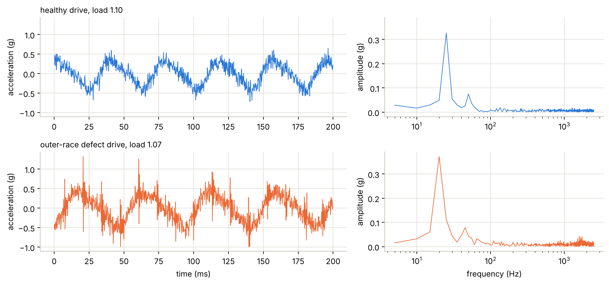
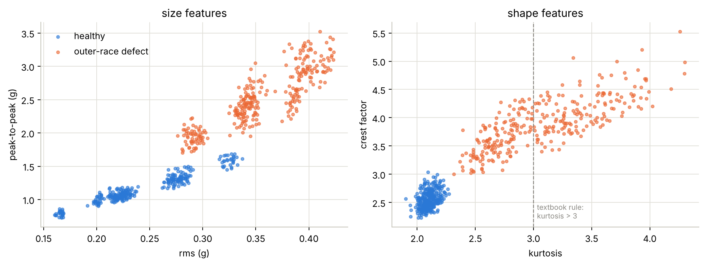
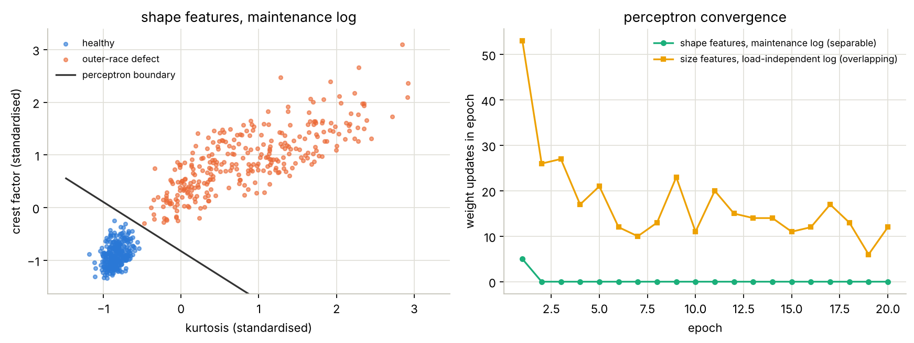
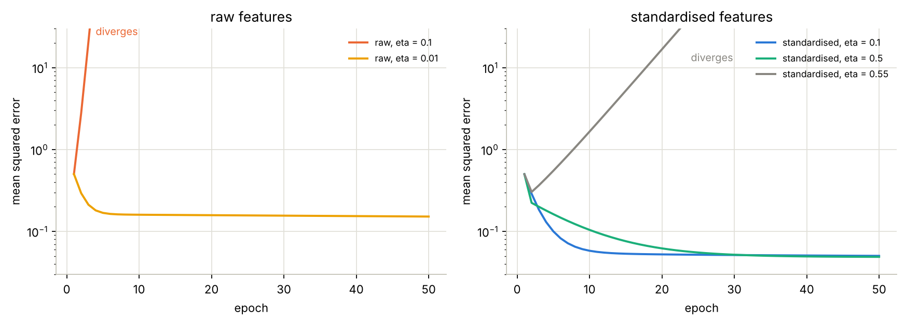
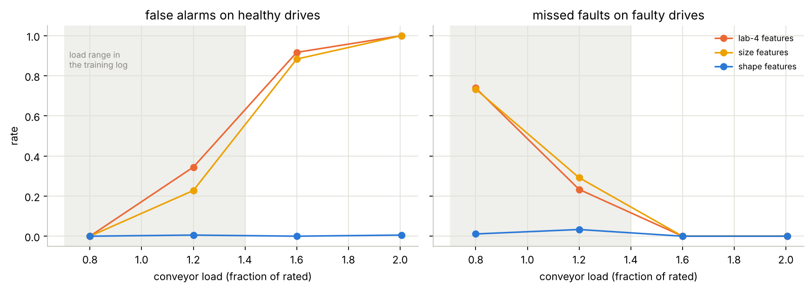

# Chapter 1. Machine Learning Next to Control and Estimation

*Part I. Foundations*

> **Case study:** an early-warning alarm for conveyor drive bearings in a packaging plant
> **Companion notebook:** [`ch01_ml_next_to_control.ipynb`](ch01_ml_next_to_control.ipynb). Every figure and number in this chapter comes from it; it needs no download and runs in under a minute on a laptop.
> **Lab:** [`labs/lab01/mlpi26_Lect01_Lab.ipynb`](../../../labs/lab01/mlpi26_Lect01_Lab.ipynb) (toolchain setup and a first classifier on bearing vibration)
> **Built from:** Lecture 0 (course introduction), Lecture 1 deck, Week 1 cheat sheet, Lab 1

You already know how to make a machine do what you want when you can write down how it works. Give a control engineer the mass, the friction and the motor constant of an axis and they will hand back a PID or LQR controller with a stability margin. Give them a noisy position sensor and a model of the axis and they will hand back a Kalman filter. Those tools are strong exactly where the physics is known.

This book is about the problems next door: the ones where the physics is partly known, too expensive to model, or buried in signals that no one can read by eye. Is that bearing starting to fail? Is that solder joint good? How hard should the gripper squeeze a part it has never seen? Machine learning answers questions like these by fitting a function to examples instead of deriving it from first principles. It does not replace control and estimation. It sits next to them, and the best systems use both.

This chapter sets up the vocabulary, the workflow and the tools for the rest of the book, and builds the smallest learning machine there is, the artificial neuron, from scratch. It ends the way every chapter in this book ends: with one experiment designed to catch the model being right for the wrong reason. In this chapter that experiment catches a fault detector that scores 99 % and is mostly measuring how heavily the conveyor was loaded.

## Learning objectives

After this chapter you should be able to:

1. Say where machine learning complements model-based control and estimation, and where it does not belong.
2. Define learning in terms of a task, a performance measure and experience, and recognise **supervised**, **unsupervised** and **reinforcement learning** problems in a robotics or automation setting.
3. Use the book's notation: feature matrix **X**, target vector **y**, model, loss, training and test sets.
4. Implement the **perceptron** and **Adaline** in NumPy, explain why the perceptron fails to stop on overlapping classes, and explain why gradient descent needs scaled features and a sensible learning rate.
5. Train and evaluate a classifier with scikit-learn's `fit` / `predict` pattern inside a `Pipeline`.
6. Design a test that separates a model that has learned the physics from one that has learned a coincidence in the data.

---

## 1.1 The engineering problem: is this bearing failing?

A packaging plant moves cartons on roller conveyors, each driven by a small induction motor through a gearbox. The drive-end bearing of each motor carries an accelerometer, and an edge device records a **0.2 s window** of vibration at 5 kHz a few times per shift. When a bearing's outer race develops a pit or a spall, the motor keeps running for weeks, then seizes and stops the line. The maintenance team wants an alarm that labels every window **healthy** or **outer-race defect**, early enough to schedule a bearing swap at the next planned stop.

The team has a log from **20 drives**, ten of them with a defect confirmed when the bearing was later removed, and 30 windows from each: 600 windows in total. The data in this chapter are simulated from standard vibration physics (Section 1.5 and the notebook give the details), so every number can be reproduced offline.



*Figure 1.1. One 0.2 s window from a healthy drive and one from a drive with an outer-race defect, at almost the same load (left), and their amplitude spectra (right, log frequency axis). The defect adds a short burst every time a rolling element strikes the pit; the bursts ring the housing at 1.5 to 2 kHz.*

By eye the difference is clear in this pair. It is far less clear in a stream of thousands of windows from motors running at different speeds and loads, and nobody is going to look at them all. The question for this chapter is how to turn the 1000 numbers in a window into a reliable yes/no, and how to know whether to trust the answer.

## 1.2 Where machine learning fits next to control

The tools you already have are **model-based**. A model-based design starts from equations you trust (rigid-body dynamics, kinematics, a motor model, a sensor noise model) and derives a controller or an estimator from them. Machine learning is **data-driven**: it starts from examples of inputs and desired outputs and fits a function that reproduces them.

| | Model-based control and estimation | Machine learning |
|---|---|---|
| Starts from | Physics: dynamics, kinematics, noise models | Examples: logged inputs and outputs |
| Typical tools | PID, LQR, MPC, Kalman and particle filters, system identification | Classifiers, regressors, clustering, neural networks, reinforcement learning |
| Strong when | The model is accurate and the operating range is known | The mapping is hard to derive but easy to demonstrate |
| Guarantees | Stability margins, observability, bounds that hold whenever the model holds | Statistical: performance on data like the training data |
| Fails by | Unmodelled effects: friction, backlash, contact, wear | Distribution shift: conditions the data never covered |

The boundary between the two columns is not sharp. A Kalman filter estimates a state from noisy data; least-squares system identification fits model parameters to logged input-output data; adaptive control updates gains online. All of these "learn from data" in the plain sense. What changes in machine learning is how much of the structure comes from the data. System identification fits a handful of parameters inside a model you wrote; a neural network may fit a million parameters inside a structure that knows nothing about the plant.

Three kinds of problem in robotics and automation keep coming back in this book, because classical tools struggle with them on their own:

- **Predictive maintenance.** The early signature of bearing wear, gear-tooth damage or a failing motor winding is buried in vibration and current signals. The physics says *where* to look (Chapter 2 builds features from it), but no equation says where to set the alarm for this machine on this line. Chapters 2 to 7 work through this family.
- **Visual inspection.** Whether a solder joint, a weld bead or a machined surface is acceptable is easy for a trained inspector to judge and very hard to write as rules. Chapter 10 trains a convolutional network to do it.
- **Learning-based control.** Contact-rich manipulation, friction-dominated joints and aerodynamic effects resist a clean analytical model. Chapters 8 and 11 learn models from data; Chapters 13 to 15 learn controllers from reward and from demonstrations, and Chapter 15 uses reinforcement learning to tune a PID controller instead of replacing it.

The stance of this book is that machine learning is a **complement** to control theory. Use physics where you have it: to choose sensors and sampling rates, to design features, to provide a safe fallback controller, and to check that a learned model behaves sensibly. Use learning for the part the physics leaves open. The case study in this chapter shows both halves working together: physics picks the features in Section 1.3, and data set the alarm threshold.

## 1.3 What it means for a machine to learn

Arthur Samuel, who wrote a checkers program in the 1950s that improved by playing against itself, described machine learning as giving computers "the ability to learn without being explicitly programmed." Tom Mitchell made it precise in 1997:

> A computer program is said to learn from experience *E* with respect to some class of tasks *T* and performance measure *P*, if its performance at tasks in *T*, as measured by *P*, improves with experience *E*.

For the bearing alarm:

- **Task *T*:** label a 0.2 s vibration window healthy or faulty.
- **Performance *P*:** the fraction of windows labelled correctly, or better (Chapter 7), the false-alarm rate and the miss rate separately, because they cost different amounts.
- **Experience *E*:** the 600 labelled windows in the maintenance log.

### A rule written by hand

Here is the traditional route. Random vibration with a Gaussian distribution has a **kurtosis** (the normalised fourth moment, Section 1.5) of 3. Impacts give the signal heavy tails and push kurtosis above 3. A common rule of thumb in condition monitoring is therefore: *raise an alarm when kurtosis exceeds 3*. The notebook applies it to the log:

```
hand rule: kurtosis > 3            accuracy 0.760   false alarms 0.000   misses 0.480
```

It never raises a false alarm, and it misses **48 %** of the faulty windows. The rule is not wrong about the physics; it is wrong about this machine. These motors vibrate with a strong sine wave at shaft speed, and a pure sine has a kurtosis of 1.5, so a healthy window here sits near 2.1, not 3. A faulty window only needs to rise a little to be clearly different from healthy ones, but it often stays below 3.

### The same rule, with the threshold learned

Keep the feature and let the data choose the threshold. The simplest possible learner puts it halfway between the largest healthy kurtosis and the smallest faulty one in the log:

```
healthy kurtosis max 2.274, faulty kurtosis min 2.316 -> threshold 2.295
data-set rule: kurtosis > 2.30     accuracy 1.000   false alarms 0.000   misses 0.000
```

Every window in the log is now labelled correctly. Nothing about this is clever, but it has all the parts of the definition: a task, a performance measure, and a parameter that improved because of experience. The engineer contributed the feature, which encodes real physics; the data contributed the number. That division of labour is the pattern for most of this book. The difference in later chapters is that the models have more parameters (a neural network in Chapter 8 has thousands) and the features themselves may be learned (Chapter 10).

Notice, too, what the 100 % does *not* tell you: whether the threshold will hold on a drive that is not in the log. Section 1.9 tests exactly that.

## 1.4 Three kinds of learning

Machine learning problems fall into three families, distinguished by what the learner is given.

**Supervised learning** learns from labelled examples: every training input comes with the correct output, the "ground truth". The bearing alarm is supervised, since every window in the log carries a label confirmed when the bearing was removed. Supervised learning splits again by the type of output:

- **Classification** predicts one of a fixed set of classes. *Is this bearing window healthy or faulty? Which bin does this part go in?* (Chapters 3, 5, 7 and 10.)
- **Regression** predicts a real number. *What joint torque do these strain-gauge readings imply? How much power will this cut draw? How many hours until this tool is worn out?* (Chapters 4, 8 and 11.)

**Unsupervised learning** finds structure in data with no labels. *Do these vibration signatures fall into natural groups? Can 40 correlated sensor channels be compressed into five without losing the information?* Clustering (k-means, DBSCAN) and dimensionality reduction (PCA) are the workhorses; Chapter 6 uses them on gearbox indicators and on a palletising cell's cycle log. Unsupervised methods matter in plants because labels are expensive: someone has to pull the bearing to confirm the fault.

**Reinforcement learning (RL)** learns by interacting with an environment. The agent observes a state, takes an action, and receives a new state and a **reward**. Nobody tells it the correct action; it has to discover which actions lead to high reward over time. *A robot arm tries grasps; successful lifts earn reward; the grasping policy improves over many trials. A drone learns to hover; an RL agent learns PID gains.* Chapters 13 to 15 cover RL, and Chapter 15b covers imitation learning, which sits between supervised learning and RL: the robot learns a policy from demonstrations instead of from reward.

| Family | The learner is given | Robotics and automation example | Chapters |
|---|---|---|---|
| Supervised: classification | Inputs and class labels | Bearing fault alarm, part sorting, defect inspection | 3, 5, 7, 10 |
| Supervised: regression | Inputs and real-valued targets | Spindle power, inverse dynamics, tool-wear forecasting | 4, 8, 9, 11 |
| Unsupervised | Inputs only | Grouping machine cycles, compressing sensor channels, anomaly flags | 6 |
| Reinforcement | States, actions and rewards from interaction | Quadrotor hover, AGV navigation, PID tuning | 13, 14, 15 |
| Imitation | Demonstrated state-action pairs | Teaching a pick-and-place skill by teleoperation | 15b |

## 1.5 Vocabulary and notation

The terms below are used in every chapter.

- A **sample** (or example, or instance) is one unit you make a prediction for: here, one 0.2 s window.
- A **feature** is one measured or computed input variable for a sample, such as the RMS of the window.
- The **label** or **target** is the correct output for a sample in supervised learning: 0 for healthy, 1 for faulty.
- A **model** is the learned function $f$ that maps features to a prediction $\hat y = f(\mathbf x)$.
- The **loss function** measures how wrong the predictions are on a set of samples. Training means choosing the model's parameters to make the loss small.
- The **training set** is the data used to fit the model; the **test set** is held out, never used for fitting, and used once to estimate how the model performs on new data. Chapter 7 adds a **validation set** for choosing between models.

With $n$ samples and $m$ features, the data form an $n \times m$ **feature matrix** $\mathbf X$, one row per sample and one column per feature, and a length-$n$ **target vector** $\mathbf y$. Bold lowercase $\mathbf x^{(i)}$ is the $i$-th row (one sample), $x_j$ is one feature, and $\hat y$ is a prediction. In code these become `X` (a 2-D array or DataFrame) and `y` (a 1-D array), which is the convention scikit-learn and PyTorch both follow.

### From a window to a row of X

A raw window is 1000 numbers, too many and too correlated for a simple classifier. The notebook reduces each window $x_1,\dots,x_N$ ($N = 1000$) to six features. The first four are the ones computed in the Week 1 lab; the last two are standard dimensionless **condition indicators**.

| feature | definition | what it measures |
|---|---|---|
| `mean` | $\bar x = \frac1N\sum_i x_i$ | sensor DC offset; no fault information |
| `std` | $\sigma = \sqrt{\frac1N\sum_i (x_i-\bar x)^2}$ | vibration energy |
| `rms` | $\sqrt{\frac1N\sum_i x_i^2}$ | vibration energy (includes the offset) |
| `ptp` | $\max_i x_i - \min_i x_i$ | largest swing in the window |
| `kurtosis` | $\frac1N\sum_i (x_i-\bar x)^4 / \sigma^4$ | heavy tails, i.e. impacts |
| `crest` | $\max_i \lvert x_i-\bar x\rvert / \sigma$ | how far the biggest peak stands above the typical level |

The first four are **size** features: double the vibration and they double. Kurtosis and crest factor are **shape** features: they are ratios of quantities with the same units, so scaling the whole signal leaves them unchanged. That distinction looks academic now. It decides the outcome of Section 1.9.

The class means in the log are:

```
                    mean    std    rms    ptp  kurtosis  crest   load
healthy            0.008  0.241  0.241  1.159     2.101  2.557  0.946
outer-race defect -0.005  0.353  0.354  2.510     3.084  3.892  1.260
```

The last column is not a feature. It is the conveyor load as a fraction of rated, recorded by the drive, and it shows something about how the log was collected: the confirmed defects came from the packaging line's two heavy-duty conveyors, where bearings wear out first, so the faulty drives in the log were also running harder (load 1.0 to 1.4) than the healthy ones (0.7 to 1.1). Nobody planned that. It is simply where the faults were found.



*Figure 1.2. The 600 windows of the maintenance log in two feature planes. Left: size features, where the drives form tight clusters and the two classes separate cleanly. Right: shape features, with the textbook kurtosis threshold of 3 marked; the learned threshold of 2.30 sits in the gap near the healthy cluster.*

Both planes look easy. Any classifier will draw a line between the colours in either one.

## 1.6 The artificial neuron

Every neural network in Chapters 8 to 15 is built from one unit, the **artificial neuron**. It computes a weighted sum of its inputs plus a bias, the **net input**

$$z = \mathbf w^\top \mathbf x + b = w_1 x_1 + w_2 x_2 + \dots + w_m x_m + b,$$

and passes $z$ through an **activation function** to produce its output. The weights $\mathbf w$ and the bias $b$ are the parameters that learning adjusts. Geometrically, $z = 0$ is a straight line in two dimensions (a plane, or hyperplane, in more), and the neuron labels points by which side of it they fall on. Two historical learning rules for this unit, from 1957 and 1960, already contain the main ideas of modern training.

### 1.6.1 The perceptron

Frank Rosenblatt's **perceptron** uses a unit step as the activation: $\hat y = 1$ if $z \ge 0$, otherwise $\hat y = 0$. It visits the training samples one at a time and nudges the parameters only when the prediction is wrong:

$$\mathbf w \leftarrow \mathbf w + \eta\,\bigl(y^{(i)} - \hat y^{(i)}\bigr)\,\mathbf x^{(i)},\qquad b \leftarrow b + \eta\,\bigl(y^{(i)} - \hat y^{(i)}\bigr).$$

The **learning rate** $\eta$ sets the step size. If a faulty window ($y = 1$) is predicted healthy ($\hat y = 0$), the weights move toward that window, raising its $z$ next time; a false alarm moves them away. A correct prediction changes nothing. One pass over the training set is an **epoch**.

The notebook implements this in about 20 lines of NumPy:

```python
class Perceptron:
    def fit(self, X, y):
        rng = np.random.default_rng(self.seed)
        self.w_ = rng.normal(0, 0.01, X.shape[1])
        self.b_ = 0.0
        self.errors_ = []
        for _ in range(self.n_epochs):
            errors = 0
            for i in rng.permutation(len(y)):
                update = self.eta * (y[i] - self.predict(X[i]))
                self.w_ += update * X[i]
                self.b_ += update
                errors += int(update != 0.0)
            self.errors_.append(errors)
        return self

    def predict(self, X):
        return (X @ self.w_ + self.b_ >= 0.0).astype(int)
```

Trained on the two standardised shape features of the maintenance log, it makes 5 updates in the first epoch and none after that:

```
updates per epoch: [5, 0, 0, 0, 0, 0, 0, 0, 0, 0, 0, 0, 0, 0, 0, 0, 0, 0, 0, 0]
```

The **perceptron convergence theorem** guarantees this: if some straight line separates the two classes perfectly, the rule finds one in a finite number of updates. The left panel of Figure 1.3 shows the line it found.



*Figure 1.3. Left: the perceptron's decision boundary on the standardised shape features of the maintenance log. Right: weight updates per epoch. On separable data (green) the updates stop after the first epoch; on overlapping data (yellow) they never stop.*

The guarantee has a catch, and the right panel shows it. The yellow curve is the same perceptron trained on the size features of a second data set (introduced in Section 1.9) in which the classes overlap. No line separates them, so there is always a misclassified sample to react to, and the weights keep jumping: still 12 updates in epoch 20. The perceptron has no notion of "nearly right"; it only knows right and wrong. Real sensor data almost always overlap a little, which is why the perceptron is a historical stepping stone rather than a tool.

### 1.6.2 Adaline: a loss function and its gradient

Bernard Widrow and Ted Hoff's **Adaline** (ADAptive LInear NEuron) fixes this by learning from the continuous net input $z$ instead of the thresholded output. It defines a **loss function**, the mean squared error between the targets and $z$,

$$L(\mathbf w, b) = \frac1n\sum_{i=1}^{n}\bigl(y^{(i)} - z^{(i)}\bigr)^2,$$

and minimises it by **gradient descent**: compute the gradient of $L$, which points uphill, and take a small step the other way. The partial derivatives are

$$\frac{\partial L}{\partial \mathbf w} = -\frac2n\sum_i \bigl(y^{(i)} - z^{(i)}\bigr)\,\mathbf x^{(i)},\qquad
\frac{\partial L}{\partial b} = -\frac2n\sum_i \bigl(y^{(i)} - z^{(i)}\bigr),$$

so each epoch performs

$$\mathbf w \leftarrow \mathbf w - \eta\,\frac{\partial L}{\partial \mathbf w},\qquad b \leftarrow b - \eta\,\frac{\partial L}{\partial b}.$$

Because the loss is a smooth bowl in the parameters, the updates shrink as the parameters approach the bottom, whether or not the classes overlap. The threshold only returns at prediction time ($\hat y = 1$ if $z \ge 0.5$). This is the template for everything that follows: choose a model with parameters, choose a differentiable loss, and follow the negative gradient. Chapter 3 replaces the squared error with the log-loss to get logistic regression; Chapter 8 stacks neurons into layers and lets PyTorch compute the gradient automatically.

Gradient descent has two knobs that the perceptron hid: the learning rate and the scale of the features. The notebook trains Adaline five ways on the shape features:

```
raw           Hessian eigenvalues [ 0.057  0.093 37.876]  -> stable for eta < 0.053
standardised  Hessian eigenvalues [0.138 2.    3.862]  -> stable for eta < 0.518
raw, eta = 0.1             loss after 1 epoch      0.501   after 50 epochs   1.46e+43   accuracy 0.500
raw, eta = 0.01            loss after 1 epoch      0.501   after 50 epochs      0.152   accuracy 0.997
standardised, eta = 0.1    loss after 1 epoch        0.5   after 50 epochs     0.0503   accuracy 0.975
standardised, eta = 0.5    loss after 1 epoch        0.5   after 50 epochs     0.0489   accuracy 0.977
standardised, eta = 0.55   loss after 1 epoch        0.5   after 50 epochs   1.87e+04   accuracy 0.040
```

The first two lines need a word of explanation. Because the squared-error loss is quadratic in the parameters, its curvature is fixed: the matrix of second derivatives (the Hessian) is $\tfrac2n\mathbf A^\top\mathbf A$, where $\mathbf A$ is $\mathbf X$ with a column of ones appended for the bias. Gradient descent on a quadratic is stable only if $\eta < 2/\lambda_{\max}$, where $\lambda_{\max}$ is the largest eigenvalue of the Hessian. A control engineer will recognise this: each epoch is a linear discrete-time system in the parameter error, and the step size must keep every eigenvalue of the iteration inside the unit circle.



*Figure 1.4. Adaline training loss per epoch. Left: raw kurtosis and crest factor. Right: the same features standardised to zero mean and unit variance. Runs that diverge ($\eta$ above the stability limit) leave the top of the plot.*

Three lessons sit in this table, and you will meet each one again with neural networks.

1. **Too large a step diverges.** Each step overshoots the bottom of the bowl by more than it started, and the loss grows geometrically, here to $10^{43}$ in 50 epochs with raw features and $\eta = 0.1$. The stability limit is set by the steepest direction of the bowl: 0.053 for raw features, 0.518 for standardised ones. Just above the limit ($\eta = 0.55$) the standardised run diverges too.
2. **Unscaled features make the bowl a narrow valley.** Kurtosis and crest factor sit around 2 to 5 and are far from zero mean, so the loss is steep in one direction and nearly flat in the others: the ratio of the largest to the smallest Hessian eigenvalue is 37.9 / 0.057, about 660. A step small enough to be stable in the steep direction crawls in the flat one, and with $\eta = 0.01$ the loss stalls at 0.152 after 50 epochs, three times what the standardised runs reach. Standardising each feature, $x_j \leftarrow (x_j - \mu_j)/\sigma_j$, cuts the ratio to 3.86 / 0.138, about 28. It cannot make the bowl perfectly round here because kurtosis and crest factor are strongly correlated (0.93), which leaves one long diagonal valley.
3. **Faster is not always better.** On standardised features $\eta = 0.5$ is just inside the limit. It zigzags across the valley in the first epochs and ends up slower than $\eta = 0.1$ for the first 30 epochs.

Standardisation uses statistics computed on the training data only; Chapter 2 explains why and builds it into a pipeline so the rule cannot be broken by accident.

## 1.7 The same thing in scikit-learn

Writing the learning rule by hand is the best way to understand it, and the last time this book does it for a classical model. From here on, models come from **scikit-learn**, and every one of them follows the same three-call pattern:

```python
from sklearn.model_selection import train_test_split
from sklearn.pipeline import make_pipeline
from sklearn.preprocessing import StandardScaler
from sklearn.linear_model import LogisticRegression

X_train, X_val, y_train, y_val = train_test_split(
    log[FEATURES], log.label, test_size=0.3, random_state=0, stratify=log.label)

clf = make_pipeline(StandardScaler(), LogisticRegression())
clf.fit(X_train[cols], y_train)          # learn the scaler's statistics, then the weights
y_hat = clf.predict(X_val[cols])         # apply both to unseen windows
clf.score(X_val[cols], y_val)            # accuracy
```

`train_test_split` holds out 30 % of the windows (180 of 600), stratified so both parts keep the 50/50 class balance, with a fixed `random_state` so the split is reproducible. `make_pipeline` chains the scaler and the classifier, so that `fit` computes the means and standard deviations on the training windows only and `predict` reuses them. **Logistic regression** is Adaline with a sigmoid activation and a log-loss; Chapter 3 derives it.

The notebook trains it on three feature sets, and adds scikit-learn's own `Perceptron` for comparison:

```
logistic regression, lab-4 features accuracy 0.994   false alarms 0.000   misses 0.011
logistic regression, size features accuracy 1.000   false alarms 0.000   misses 0.000
logistic regression, shape features accuracy 0.994   false alarms 0.000   misses 0.011
sklearn Perceptron, shape features accuracy 1.000   false alarms 0.000   misses 0.000
```

The "lab-4" set is the four features from the Week 1 lab (`mean`, `std`, `rms`, `ptp`). All four models score 99 % or better on the held-out windows. By this test there is nothing to choose between them, and an engineer under time pressure would ship the first one that worked.

### The workflow every chapter follows

The bearing alarm has already passed through the four stages that structure every project in this book:

1. **Preprocess.** Turn raw signals into a table, handle gaps and glitches, scale, and split (Chapter 2).
2. **Train and select.** Fit candidate models and compare them fairly (Chapters 3 to 6, 8 to 12).
3. **Evaluate.** Estimate performance on data the model has not seen, with metrics that match the cost of each mistake (Chapter 7).
4. **Deploy and iterate.** Run the model on the line, monitor it, and retrain when the plant changes (Chapters 16 and 17).

The arrows run backwards as often as forwards. An evaluation that fails sends you back to the features; a deployment that drifts sends you back to the data. The next section is an example of the first.

## 1.8 The toolbox

This book uses one language and four libraries:

| Tool | Role | Used in |
|---|---|---|
| **Python** | The language for everything | all chapters |
| **NumPy** | Arrays and numerical computing; the simulators and the from-scratch models | all chapters |
| **pandas** | Loading, cleaning and summarising tabular logs | Chapters 1 to 7 especially |
| **scikit-learn** | Classical models, preprocessing, pipelines, evaluation | Chapters 1 to 7 |
| **PyTorch** | Tensors, automatic differentiation, neural networks, GPU training, export | Chapters 8 to 16 |

Plus matplotlib for figures and SciPy for signal processing and statistics.

**When to reach for which.** Use scikit-learn for tabular data: one row per sample, tens to hundreds of engineered features, thousands to hundreds of thousands of rows. Its models train in seconds, are easy to inspect, and are often the right production choice. Reach for PyTorch when the input is raw and high-dimensional (images, long time series, point clouds), when you need a custom architecture or loss, or when the model will itself be part of a control loop (Chapters 14 and 15). Both libraries share the same idea of a model that is fit to data and then asked for predictions; Chapter 8 rewrites the `fit` / `predict` pattern as PyTorch's tensor, model, `loss.backward()`, `optimizer.step()` loop.

### Setting up an environment

Create an isolated environment per project so that library versions do not collide. With `uv`:

```bash
uv init mlpi && cd mlpi
uv add numpy pandas scipy matplotlib scikit-learn torch jupyter
uv run jupyter lab
```

With conda:

```bash
conda create -n mlpi python=3.13 -y
conda activate mlpi
pip install numpy pandas scipy matplotlib scikit-learn torch jupyter
```

The first cell of every companion notebook prints the versions it ran with. This chapter's notebook was executed with Python 3.13, NumPy 2.5, pandas 3.0, SciPy 1.18, matplotlib 3.11 and scikit-learn 1.9; PyTorch is not needed until Chapter 8. If an import fails, check that the environment is activated before Jupyter starts, not inside a notebook cell.

## 1.9 The decisive experiment: fault or load?

Each chapter in this book ends its case study with one experiment designed to catch the model being right for the wrong reason. The validation set in Section 1.7 was cut from the same log as the training set, so it carries the same coincidence: faulty drives were running harder. A model can score 99 % on that log by recognising **load**, because in that log, load and condition go together.

The test is to break the coincidence. The plant logs a second campaign: **40 new drives**, half of them faulty, 30 windows each, with load spread from 0.6 to 2.2 of rated *independently* of condition. Peak season pushes some healthy conveyors well past their rated load; some faulty drives sit on lightly loaded lines. The models from Section 1.7 are applied as they are, with nothing refitted:

```
lab-4 features on new drives       accuracy 0.618   false alarms 0.495   misses 0.268
size features on new drives        accuracy 0.632   false alarms 0.457   misses 0.278
shape features on new drives       accuracy 0.993   false alarms 0.003   misses 0.010
data-set rule kurtosis > 2.30      accuracy 0.998   false alarms 0.003   misses 0.002
```

Two models that scored 99.4 % and 100 % on validation fall to 62 % and 63 %, barely better than a coin. The shape model and the one-line kurtosis rule hold at 99 % and above. Breaking the result down by load shows what the failing models learned:

| load (fraction of rated) | lab-4 features: false alarms | lab-4 features: misses | shape features: false alarms | shape features: misses |
|---|---|---|---|---|
| 0.6 to 1.0 | 0.00 | 0.74 | 0.00 | 0.01 |
| 1.0 to 1.4 | 0.34 | 0.23 | 0.01 | 0.03 |
| 1.4 to 1.8 | 0.92 | 0.00 | 0.00 | 0.00 |
| 1.8 to 2.2 | 1.00 | 0.00 | 0.01 | 0.00 |



*Figure 1.5. False-alarm rate on healthy drives (left) and miss rate on faulty drives (right) against conveyor load, for the three logistic-regression models of Section 1.7, on 40 new drives whose load is independent of their condition. The shaded band is the load range of the training log.*

The lab-4 model is a **load meter**. It raises an alarm on every healthy drive pushed past 1.4 of rated, and it sleeps through three quarters of the faults on lightly loaded conveyors, the drives where a seized bearing would be least expected. The fitted weights confirm it: on standardised features the lab-4 model puts a weight of 5.17 on peak-to-peak and about 1 or less on everything else, and in the training log peak-to-peak correlates with load at 0.80. Within the healthy class alone, RMS still correlates with load at 0.75; kurtosis and crest factor correlate at 0.04 and 0.02. A heavier load scales the whole signal, and a ratio of two quantities that both scale cancels the load out.

Three lessons from this experiment run through the rest of the book.

- **A held-out score measures performance on data like the training data, nothing more.** The validation windows shared the training log's coincidence, so they could not expose it. Chapter 2 meets the same problem with machines instead of loads (a random split lets a model recognise the machine), Chapter 7 makes the choice of split a design decision, and Chapter 16 calls it distribution shift.
- **Physics is the cheapest defence.** Nothing in the data told us to prefer kurtosis over peak-to-peak; both separated the log perfectly. Knowing that a defect changes the *shape* of the signal while load changes its *size* did. This is the sense in which machine learning complements engineering rather than replacing it.
- **Design the test to break the shortcut.** The decisive question was not "how accurate is the model?" but "what else could explain this accuracy?" Load was recorded, so it could be checked. The habit to build is to list the variables that changed together with the label in your data, and then find or collect data in which they do not.

## Summary

- Model-based control and estimation are strong where the physics is known. Machine learning fits a function to examples where the physics leaves the answer open. It complements control theory; it does not replace it.
- A program learns when its performance *P* on a task *T* improves with experience *E*. Even choosing one alarm threshold from data is learning: the textbook rule (kurtosis > 3) missed 48 % of faults; the learned threshold (2.30) missed none in the log.
- **Supervised** learning uses labelled examples (classification for classes, regression for numbers); **unsupervised** learning finds structure without labels; **reinforcement** learning learns actions from reward.
- Data are an $n \times m$ feature matrix $\mathbf X$ and a target vector $\mathbf y$. A model maps features to predictions; a loss measures how wrong they are; training minimises the loss on the training set; the test set is used once.
- The **perceptron** updates only on mistakes and stops only if the classes are linearly separable. **Adaline** minimises a squared-error loss by **gradient descent**, which converges on overlapping data too, provided the learning rate is small enough and the features are standardised.
- scikit-learn's `fit` / `predict` / `score`, wrapped in a `Pipeline`, is the pattern for Chapters 2 to 7.
- A 99 % validation score can hide a model that learned a coincidence. Here, size features learned load and fell to 62 % on drives where load and condition were independent; dimensionless shape features held at 99 %.

## Exercises

1. **Your own definition.** Write down *T*, *P* and *E* for (a) a vision system that rejects mislabelled cartons, (b) a model that predicts a robot joint's motor current from its trajectory, (c) a controller that learns to balance an inverted pendulum. Which family of learning is each?
2. **Kurtosis of a sine.** Show analytically that $x(t) = A\sin(\omega t)$ has kurtosis 1.5 for any amplitude $A$, and that Gaussian noise has kurtosis 3. Use the results to explain why the healthy windows in the log sit near 2.1.
3. **Perceptron learning rate.** Train the from-scratch `Perceptron` on the standardised shape features with $\eta$ = 0.001, 0.1 and 10. Does the number of epochs to converge change? Show that, with zero initial weights, the learning rate only rescales $\mathbf w$ and $b$ and cannot change the predictions.
4. **Adaline on four features.** Train `Adaline` on standardised `rms`, `ptp`, `kurtosis` and `crest` from the maintenance log. Inspect the weights. Which features does it lean on, and how does it perform on the load-independent campaign?
5. **Remove the coincidence.** Regenerate the maintenance log with both classes at load 0.7 to 1.4 (the notebook's exercise cell has the call) and repeat Sections 1.7 and 1.9. Does the lab-4 model still fail? Does it fail less? Explain using Figure 1.2.
6. **Early-stage faults.** Lower the defect severity in the simulator from 0.6 to 1.0 down to 0.2 to 0.4. At what severity does the shape model start missing faults? Plot its miss rate against severity.
7. **What else could explain it?** For the part-sorting conveyor of Chapter 3 and the grasp-failure predictor of Chapter 7, list two variables that might change together with the label in a real plant log, and describe the data you would collect to break each coincidence.

## Further reading

- A. L. Samuel, "Some studies in machine learning using the game of checkers," *IBM Journal of Research and Development* 3(3) (1959) 210–229.
- T. M. Mitchell, *Machine Learning*, McGraw-Hill, 1997. Chapter 1 gives the *T*, *P*, *E* definition.
- F. Rosenblatt, "The perceptron: a probabilistic model for information storage and organization in the brain," *Psychological Review* 65(6) (1958) 386–408.
- B. Widrow and M. E. Hoff, "Adaptive switching circuits," *IRE WESCON Convention Record* 4 (1960) 96–104.
- A. Ng, *CS229 Lecture Notes*, Stanford University, 2023: <https://cs229.stanford.edu/main_notes.pdf>. Supervised learning, gradient descent and the perceptron from first principles.
- A. Zhang, Z. C. Lipton, M. Li and A. J. Smola, *Dive into Deep Learning*, 2023: <https://d2l.ai/>. Free, executable, and a good companion for Chapters 8 to 12.
- R. B. Randall and J. Antoni, "Rolling element bearing diagnostics — A tutorial," *Mechanical Systems and Signal Processing* 25(2) (2011) 485–520. The physics behind the simulator and the shape features.
- L. Ljung, *System Identification: Theory for the User*, 2nd ed., Prentice Hall, 1999. Where control engineers already learn models from data.
- scikit-learn User Guide, "Getting started": <https://scikit-learn.org/stable/getting_started.html>
