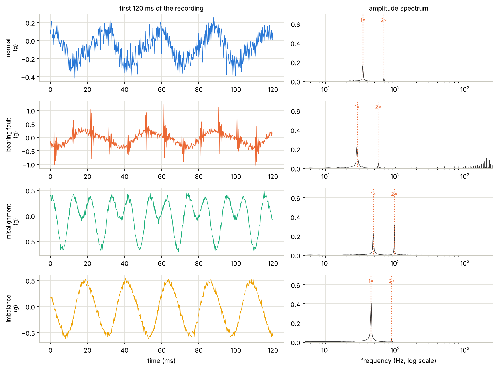
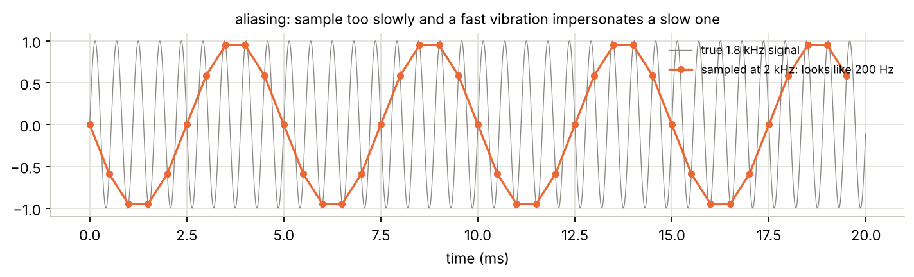
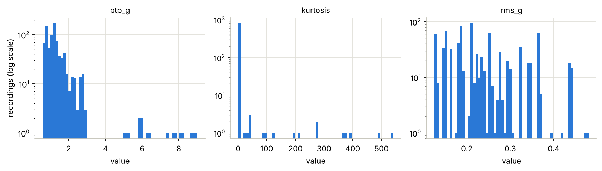
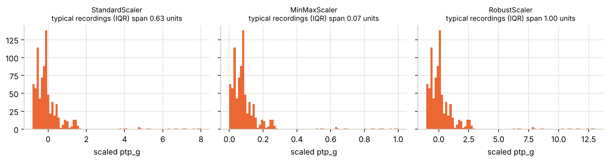
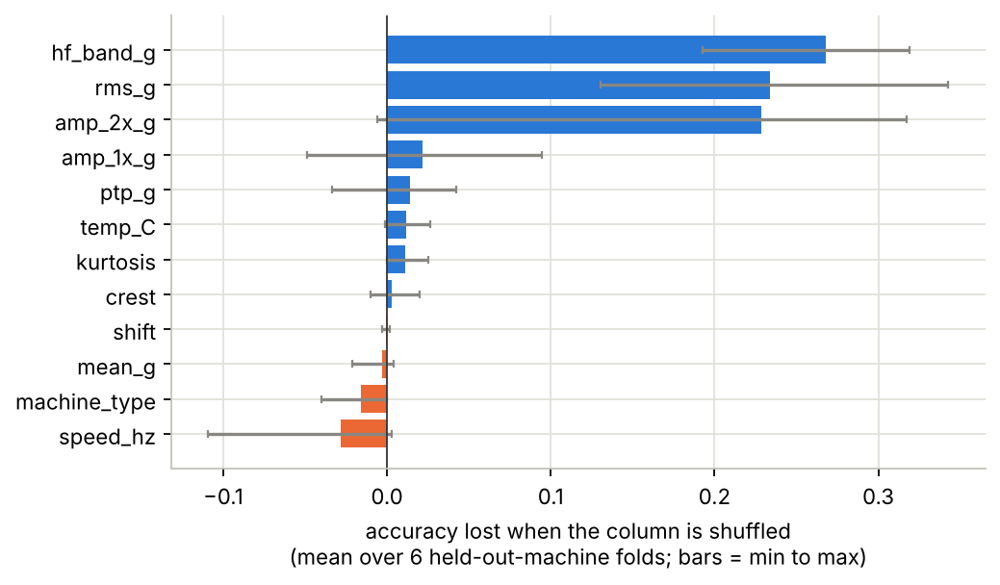
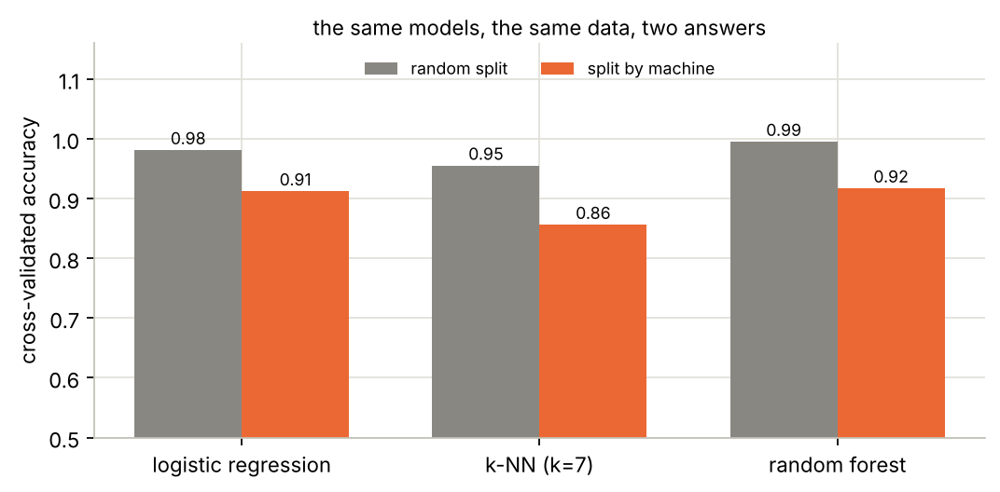

# Chapter 2 — Data from Machines: Sensors, Preprocessing and Pipelines

> **Companion notebook:** [`ch02_data_from_machines.ipynb`](ch02_data_from_machines.ipynb).
> Every figure and number in this chapter comes from it; it needs no download.

## 2.1 Before the model

A maintenance team wants to recognise four conditions of the rotating machines on its shop floor:
**normal**, **bearing fault**, **misalignment** and **imbalance**. Every machine carries an
accelerometer on its bearing housing, a tachometer on its shaft and a temperature probe, and an
edge device records one second of vibration a few times per shift.

The classifiers of Chapter 3 all expect the same thing: a table with one row per example and one
numeric column per feature, with no gaps. Getting from a stream of raw signals to that table is
most of the work in industrial machine learning, and the decisions made here — what to measure, how
to fill gaps, how to scale, how to split — limit what any model can achieve afterwards. This
chapter follows one data set from the sensor to a deployable scikit-learn pipeline, and ends with
the experiment that decides whether the reported accuracy can be believed.

## 2.2 From vibration to numbers

### What each fault looks like

The notebook's simulator follows standard vibration-analysis physics. A shaft turning at $f$ Hz
vibrates at $1\times f$; **imbalance** raises that component. **Misalignment** raises the
$2\times f$ harmonic. A **bearing outer-race defect** produces an impact every time a rolling
element passes it — at the *ball-pass frequency* $\text{BPFO}\approx3.58f$ for this bearing — and
each impact rings the housing's structural resonance (1.2–2.2 kHz), which decays within a few
milliseconds. On top come electrical noise, a DC offset in the sensor, and a mounting gain that
differs from machine to machine.



*Figure 2.1 — The first 120 ms of one recording per condition (left) and the amplitude spectrum
of the full second (right, log frequency axis). Dotted lines mark $1\times$ and $2\times$ shaft
speed.*

Imbalance is a larger sine wave; misalignment adds a wave at twice the frequency; the bearing fault
adds sharp periodic bursts whose energy appears far up the spectrum, near the resonance.

### Sampling

The edge device samples at $f_s=5$ kHz. By the **Nyquist–Shannon theorem** a sampled signal can
only represent frequencies below $f_s/2$. A component above that limit is not lost but
**aliased**: it reappears at a false lower frequency.



*Figure 2.2 — A 1.8 kHz vibration sampled at 2 kHz is indistinguishable from a 200 Hz one.*

Aliasing cannot be undone after sampling, which is why acquisition hardware places an analogue
anti-aliasing filter before the converter. Choose $f_s$ from the highest frequency you need — here
the bearing resonance — with margin. It is the one data-quality decision no later step can repair.

### Condition indicators

A one-second recording is 5000 numbers. The edge device reduces it to a handful of **condition
indicators**:

| feature | definition | sensitive to |
|---|---|---|
| `mean_g` | average acceleration | sensor DC offset (no fault information) |
| `rms_g` | $\sqrt{\frac1N\sum(x-\bar x)^2}$ | overall vibration energy |
| `ptp_g` | max − min | single large events, including glitches |
| `kurtosis` | $\frac1N\sum(x-\bar x)^4/\text{rms}^4$ | impulsiveness (1.5 for a sine, 3 for Gaussian noise) |
| `crest` | peak / RMS | impulsiveness |
| `amp_1x_g`, `amp_2x_g` | spectrum amplitude at $1\times$, $2\times$ shaft speed | imbalance; misalignment |
| `hf_band_g` | RMS of the 1.0–2.4 kHz band | bearing impacts ringing the resonance |

These are **features designed from the physics of the faults**. Later chapters learn features
directly from raw signals with neural networks, but hand-built indicators remain the backbone of
industrial condition monitoring because they are cheap, explainable and robust. Note one
dependency: the order amplitudes need the shaft speed, so a tachometer dropout removes three
columns at once.

## 2.3 The fleet log

Twenty-four machines — eight CNC mills, eight presses, eight lathes — were logged during a campaign
of several weeks, 35 recordings each, for 840 rows. Each machine was in **one** condition for the
whole campaign; a misaligned coupling stays misaligned until someone fixes it. The log also holds
the mess every plant historian holds:

* **tachometer dropouts**, which blank `speed_hz`, `amp_1x_g` and `amp_2x_g` (10.5 % of rows);
* **temperature-probe gaps** (3.3 % of rows);
* **electrostatic spikes** on the sensor cable in about 2 % of recordings;
* metadata columns that are not measurements: `machine_id`, `machine_type`, `shift`.

`DataFrame.describe()` already shows two problems: `count` is below 840 for four columns, and
`kurtosis` and `ptp_g` have maxima (540 and 9.0) far beyond their 75th percentiles (2.8 and 1.4).

## 2.4 Missing data

scikit-learn estimators refuse `NaN`, so every gap needs a decision. Before making one, look at
*where* the gaps are:

| machine type | `speed_hz` missing | `temp_C` missing |
|---|---|---|
| CNC | 5.7 % | 3.9 % |
| lathe | 5.0 % | 3.9 % |
| press | **20.7 %** | 2.1 % |

Temperature gaps occur at the same rate everywhere: they are **missing completely at random**.
Tachometer gaps are four times more common on presses: they are **not missing at random** with
respect to machine type, and that changes what each strategy does.

| strategy | what it does | risk |
|---|---|---|
| **drop** | delete rows with any gap | wastes data; skews what remains if gaps are not random |
| **impute** | fill with the training column's mean or median | hides that the value was missing |
| **flag and fill** | impute and add a 0/1 "was missing" column | one extra column per affected feature |

Dropping keeps 727 of 840 rows (87 %) and shifts the fleet from one-third presses to 30 %:
exactly the machines with the least reliable sensors become the least represented.

### Mean or median?

With outliers present, the mean is dragged toward them and the median is not. The mean kurtosis of
the log is 6.8; the median is 2.2. A few spiky recordings decide the mean. **The median is the
robust default for sensor features.**

### Comparing strategies fairly

The notebook compares the strategies with the same logistic-regression pipeline and the evaluation
scheme of §2.9 (cross-validation that holds out whole machines):

| strategy | rows used | accuracy | std across folds |
|---|---|---|---|
| drop rows with gaps | 727 | 0.964 | 0.071 |
| impute mean | 840 | 0.913 | 0.082 |
| impute median | 840 | 0.929 | 0.080 |
| median + missing flags | 840 | 0.912 | 0.083 |

Dropping *appears* to win, but its score comes from a different, easier test set. The 113
recordings it discarded — mostly presses with a dead tachometer — will still arrive in production,
and a model built on complete rows has no answer for them. **Two strategies can only be compared on
the same rows.** Among the strategies that keep every row, the differences are far smaller than the
fold-to-fold spread, so this data does not prefer one. The lasting lesson is procedural: decide
deliberately, do it inside the pipeline, evaluate on the data you will really face. Flag-and-fill
is cheap insurance for the case where missingness is itself a symptom — a tachometer that drops out
*because* the machine is shaking badly.

## 2.5 Outliers and feature scaling

### Glitches

An electrostatic discharge adds a spike of several g for about a millisecond. It is not vibration,
but `ptp_g`, `crest` and `kurtosis` take it at face value.



*Figure 2.3 — Histograms on a logarithmic count axis. Spikes give `ptp_g` and `kurtosis` long
tails; `rms_g`, which averages energy over 5000 samples, barely notices them. The clumps in the RMS
histogram are individual machines.*

There are three remedies: remove spikes at the signal level (a median filter on the waveform, if
you control the edge code), clip the affected features, or use preprocessing that is robust to a few
extreme values.

### Three scalers

| scaler | transform | sensitive to outliers? |
|---|---|---|
| `StandardScaler` | $(x-\mu)/\sigma$ | yes: one spike inflates $\sigma$ |
| `MinMaxScaler` | $(x-\min)/(\max-\min)$ | very: one spike sets the maximum |
| `RobustScaler` | $(x-\text{median})/\text{IQR}$ | no |



*Figure 2.4 — The same `ptp_g` column after each scaler. The shapes are identical; the units are
not. After `MinMaxScaler` the middle half of all recordings fits in a band 0.07 wide.*

For distance-based models this matters directly. Accuracy with machines held out:

| scaler | k-NN (k = 7) | logistic regression |
|---|---|---|
| none | 0.402 | 0.846 |
| `MinMaxScaler` | 0.663 | 0.877 |
| `StandardScaler` | 0.870 | 0.929 |
| `RobustScaler` | **0.930** | **0.942** |

Unscaled, k-NN's distances are dominated by whichever columns have the largest raw numbers
(temperature in °C, speed in Hz), and it barely beats guessing among four classes. `MinMaxScaler`
helps least because the spikes set its range; `RobustScaler` does best for both models here.
Logistic regression is less sensitive but not immune, because scaling changes how its
regularisation penalty treats each weight. Trees (Chapter 3) need no scaling.

## 2.6 Categorical fields

`machine_type` is text. Passing it straight to a model raises an error; mapping CNC, press, lathe to
0, 1, 2 invents an **order** and a **distance** that linear models and k-NN take literally.
**One-hot encoding** gives each category its own 0/1 column:

| `machine_type` | `machine_type_CNC` | `machine_type_lathe` | `machine_type_press` |
|---|---|---|---|
| CNC | 1 | 0 | 0 |
| lathe | 0 | 1 | 0 |
| robot *(never seen in training)* | 0 | 0 | 0 |

Use `OneHotEncoder(handle_unknown="ignore")`: a category that first appears at deployment — the
plant buys a robot cell — is encoded as all zeros rather than stopping the line with an exception.

Not every logged categorical field belongs in a model. `shift` is recorded for every row, but the
fault does not care who is on shift; §2.8 confirms the model agrees.

## 2.7 Pipelines

Imputation, scaling, encoding and the model all have to be fitted on training data only and applied
identically to every new row. Done by hand, this is where leaks and train/deploy mismatches creep
in. scikit-learn provides two building blocks:

* a **`ColumnTransformer`** routes each group of columns to its own preprocessing;
* a **`Pipeline`** chains that with the model into one estimator with one `fit` and one `predict`.

```
               ┌─ numeric: SimpleImputer(median, flags) → StandardScaler ─┐
raw table ─────┤                                                          ├─► model
               └─ categorical: OneHotEncoder(handle_unknown="ignore") ────┘
```

```python
full_pre = ColumnTransformer([
    ("num", make_pipeline(SimpleImputer(strategy="median", add_indicator=True),
                          StandardScaler()), NUM),
    ("cat", OneHotEncoder(handle_unknown="ignore"), CAT),
])
pipe = Pipeline([("pre", full_pre), ("clf", LogisticRegression(max_iter=3000))])
```

Twelve raw columns become twenty model inputs — ten scaled numeric features, four missing-value
flags and six one-hot columns — without a line of manual bookkeeping. Cross-validation then refits
the imputer, scaler and encoder inside every training fold automatically. From here on, **every
model in this book is evaluated as a pipeline.**

## 2.8 Which features matter?

Two quick ways to ask a fitted pipeline which inputs it relies on:

* **L1-regularised logistic regression** drives the weights of unhelpful inputs to exactly zero
  (Chapter 4 explains why);
* **permutation importance** shuffles one raw column at a time in held-out data and measures the
  accuracy lost.

With a strong L1 penalty, the model keeps one main input per fault — `hf_band_g` for the bearing
fault, `amp_2x_g` for misalignment, `rms_g` (dominated by the $1\times$ component) for imbalance —
and zeroes out `shift`, `machine_type`, the missing-value flags and most of the rest.



*Figure 2.5 — Permutation importance of each raw column, averaged over six folds that each hold
out whole machines; whiskers show the range across folds. Orange bars are negative.*

Permutation importance agrees: the high-frequency band, RMS and the $2\times$ amplitude carry the
decisions; `shift` is worthless. Two details deserve a second look.

* L1 also kept `mean_g` — the sensor's DC offset — for the *normal* class. An offset has no
  physical connection to a fault. When such a feature appears useful, treat it as an alarm, not a
  discovery.
* `speed_hz` and `machine_type` have **negative** importance on held-out machines: shuffling them
  makes predictions on new machines *better*. Both describe *which machine* a recording came from
  rather than its condition, and the model leans on them in a way that does not transfer.

Both observations point at the same problem, which the next section measures.

## 2.9 The decisive experiment: split by machine

Every evaluation in this chapter so far has held out whole machines. Here is what a random split
would have reported instead:

* **random split** — 5-fold stratified cross-validation over recordings; recordings from the same
  machine fall in both training and test folds;
* **split by machine** — 6-fold `StratifiedGroupKFold` with `groups=machine_id`; each fold holds out
  complete machines.



*Figure 2.6 — Cross-validated accuracy of three models under the two splitting schemes.*

| features | model | random split | split by machine | gap |
|---|---|---|---|---|
| all | logistic regression | 0.981 | 0.912 | 0.069 |
| all | k-NN (k = 7) | 0.955 | 0.856 | 0.099 |
| all | random forest | 0.995 | 0.917 | 0.079 |
| without `mean_g` | logistic regression | 0.979 | 0.930 | 0.049 |
| without `mean_g` | k-NN (k = 7) | 0.950 | 0.888 | 0.062 |
| without `mean_g` | random forest | 0.995 | 0.921 | 0.074 |

**Every model looks better under the random split, and the gap is the size of the leak.** When
recordings from the same machine sit on both sides of the split, a model can partly recognise *the
machine* — its mounting gain, noise floor, sensor offset, running speed — and since each machine
had only one condition, recognising the machine is enough to "diagnose" it. On a machine it has
never seen, that shortcut is worth nothing. A random-split report of 99.5 % for the random forest would
have promised the maintenance manager an error rate of 0.5 %; on new machines it is about 8 %,
some sixteen times higher.

Removing `mean_g`, the most obvious fingerprint, narrows the gap — a lot for k-NN, barely for the
random forest — but closes it for none, because the fingerprint is spread across many features. Feature surgery is not the
fix. **The fix is the split: hold out the unit you will deploy to** — a new machine, a new robot, a
new batch, a new day. In scikit-learn that means passing `groups=` to a group-aware splitter
(`GroupKFold`, `StratifiedGroupKFold`, `GroupShuffleSplit`). Chapter 7 returns to this, together with
hyperparameter tuning, where the same mistake hides in subtler forms.

## 2.10 Shipping the pipeline

Because preprocessing and model are one object, deployment is one file:

```python
joblib.dump(final_pipeline, "fault_pipeline.joblib")
loaded = joblib.load("fault_pipeline.joblib")
loaded.predict(new_rows)          # raw rows: NaNs and text categories included
```

The notebook feeds the loaded pipeline two raw rows: one from a lathe whose tachometer dropped
out, and one from a "robot" machine type never seen in training. Both are imputed, encoded and
classified with no special code. What the pipeline cannot report is how far to trust the second
prediction; a new kind of machine is exactly the distribution shift that Chapters 7 and 16 deal
with.

## Summary

* Sampling rate and sensor placement decide what information exists; no model recovers aliased or
  unrecorded content.
* Condition indicators built from fault physics turn waveforms into a table.
* **Missing data:** look at where it is missing before choosing to drop, impute or flag; compare
  strategies only on the same rows; prefer the median for sensor features.
* **Outliers** from glitches distort peak-based features and min–max scaling; use signal-level
  filtering or robust statistics.
* **Categorical fields:** one-hot encode with `handle_unknown="ignore"`; never invent an order.
* **Pipelines** make "fit on training data only" automatic and give a single deployable object.
* **Split by the unit you deploy to.** Random splits over recordings from the same machines
  measure memory, not diagnosis.

## Exercises

1. Raise the press tachometer dropout rate to 50 % and repeat the comparison of missing-data
   strategies. Which one degrades most?
2. Apply a median filter (`scipy.signal.medfilt`, kernel 5) to each waveform before feature
   extraction. What happens to the tails of `ptp_g` and `kurtosis`, and to the bearing-fault
   features?
3. Encode `machine_type` as 0/1/2 instead of one-hot and compare k-NN accuracy with machines held
   out.
4. Lower the simulator's sampling rate to 2 kHz. Which feature breaks, and what does the
   bearing-fault spectrum look like now?
5. Repeat §2.9 holding out whole **machine types** (all lathes in one fold). Is that a fairer test
   for a plant about to buy its first grinder?
