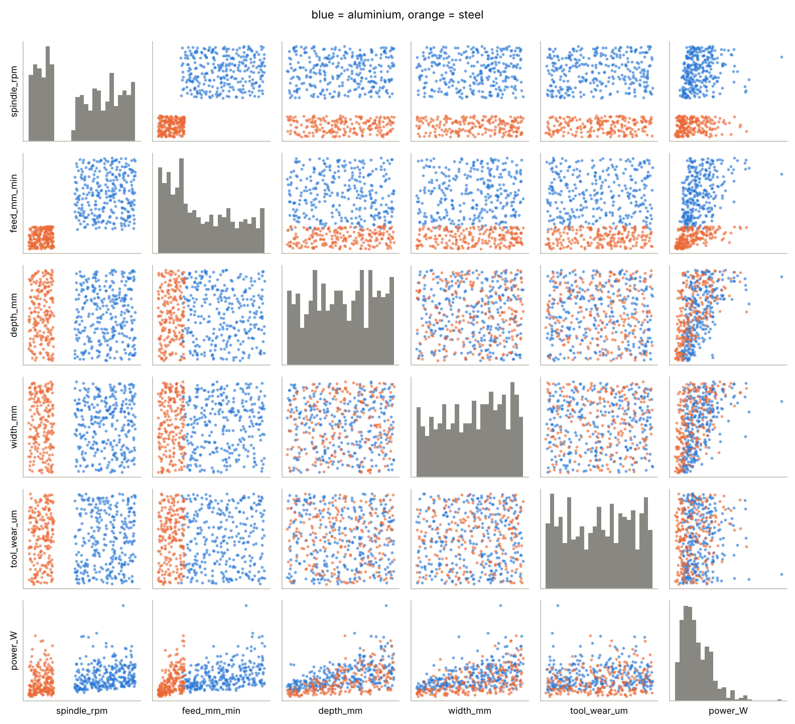
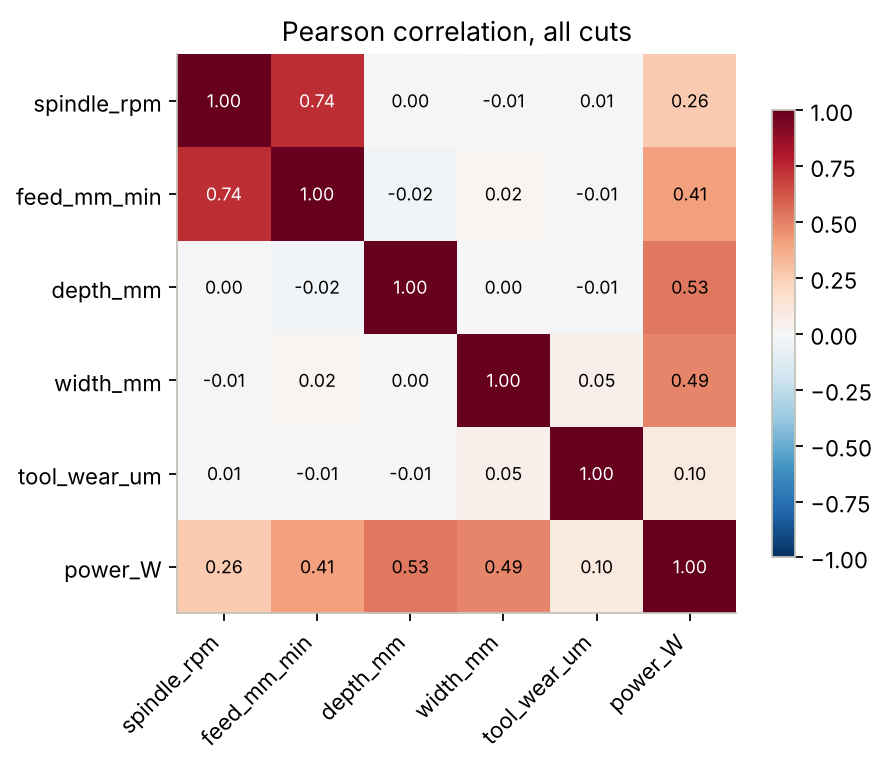
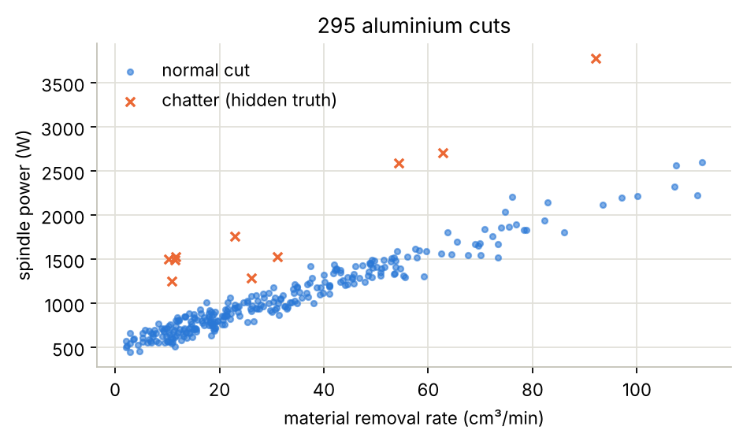
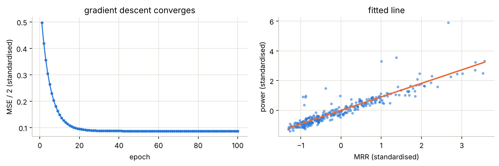
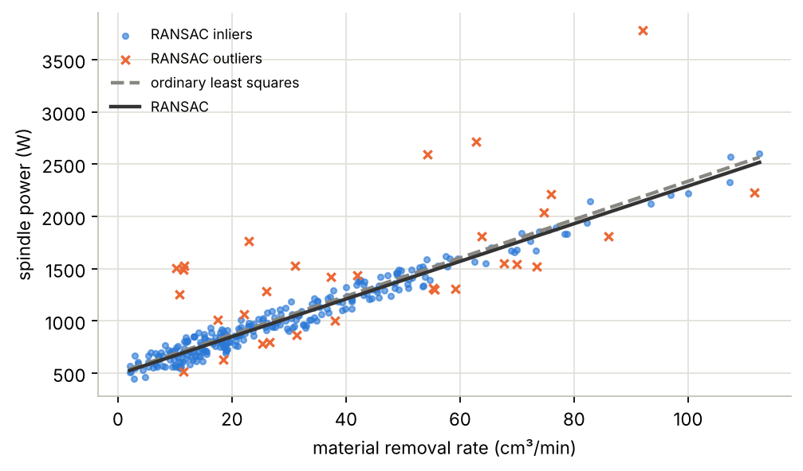
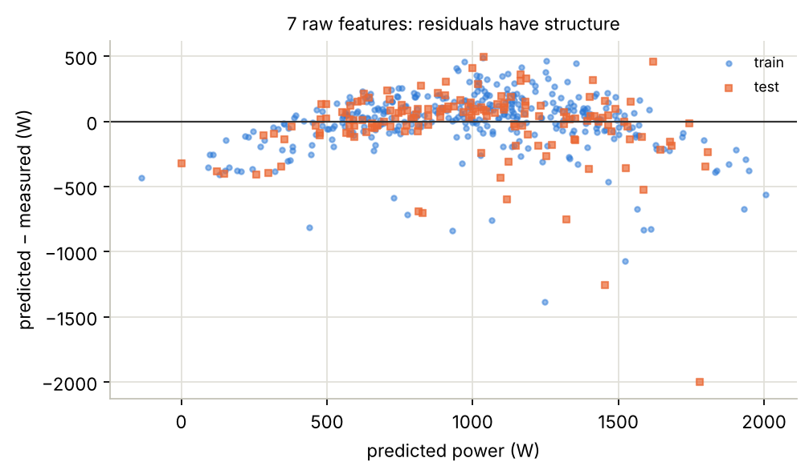
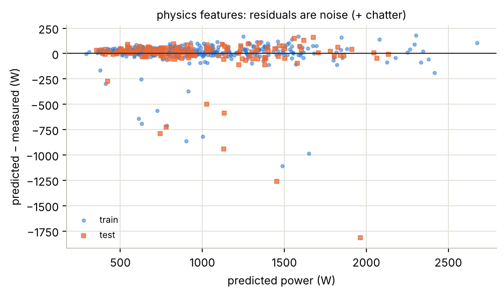
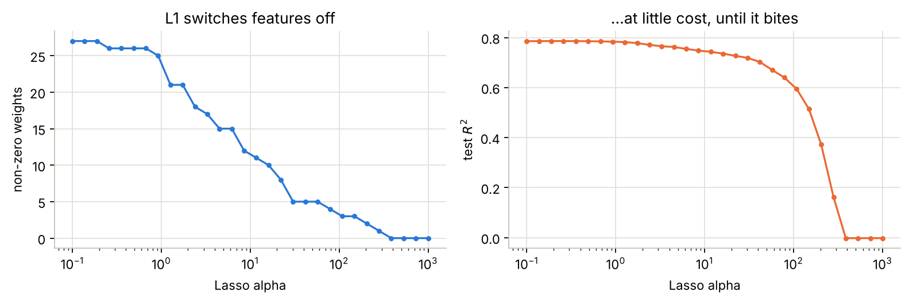
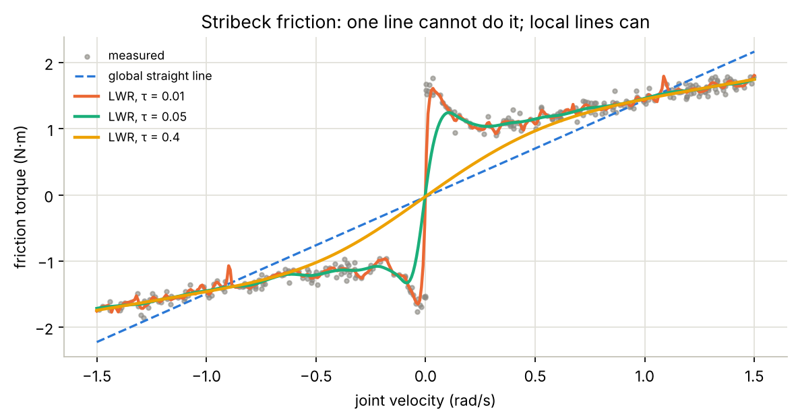

# Chapter 4 — Regression: Predicting Spindle Power on a CNC Mill

> **Companion notebook:** [`ch04_regression.ipynb`](ch04_regression.ipynb). Every figure and
> number in this chapter comes from it; it needs no download.

## 4.1 The problem

A machining cell logs every cut its 3-axis mill makes: the cutting parameters the CAM program
commanded, the workpiece material, the measured flank wear of the tool at its last check, and the
**spindle power** the drive actually drew. The process engineers want to predict that power
*before* a cut runs, in order to

* reject NC programs that would overload the spindle,
* estimate the energy cost of each part, and
* notice cuts whose measured power is far above the prediction — a symptom of chatter or of a
  worn or chipped tool.

The target is a continuous number, so this is **regression**. The chapter builds regression
models from the simplest one — a straight line through one feature — to multi-feature models with
physics-informed features and regularisation, and ends with a non-parametric method for a
strongly nonlinear robotics relationship, joint friction.

### Physics first

The power that goes into cutting is the **specific cutting energy** $u$ of the material
(J/mm³, a handbook value) times the **material removal rate** (MRR, mm³/s):

$$P_\text{cut}=u\cdot\text{MRR},\qquad \text{MRR}=a_p\,a_e\,v_f,$$

where $a_p$ is the axial depth of cut, $a_e$ the radial width and $v_f$ the feed rate. On top of
that the spindle draws an **idle power** that grows with speed (bearings, fan, drive losses), a
worn tool needs more energy per mm³, and the drive converts electrical to mechanical power with
roughly 85 % efficiency.

The notebook's simulator follows exactly this model, with $u = 0.8$ J/mm³ for aluminium 6061 and
$2.6$ J/mm³ for steel 1045, 4 % measurement noise, and about 3 % of cuts that **chattered** —
a self-excited vibration that inflates the measured power by 40–120 %. It produces 500 logged
cuts with the columns `material`, `spindle_rpm`, `feed_mm_min`, `depth_mm`, `width_mm`,
`tool_wear_um`, `coolant` and the target `power_W`.

## 4.2 Exploring the data

*Figure 4.1 — Pairwise scatter plots; blue = aluminium, orange = steel.*

*Figure 4.2 — Pearson correlation between the numeric columns.*

The two exploratory plots already teach two lessons.

1. **Confounding.** Spindle speed and feed are strongly correlated, not because one causes the
   other but because aluminium is cut fast and steel slowly. The material drives both.
2. **Products are invisible to correlation.** No single raw column correlates strongly with
   power. Power depends on the *product* depth × width × feed, and the Pearson coefficient only
   measures linear association with one variable at a time.

## 4.3 Simple linear regression

Start with aluminium cuts and one feature, the MRR in cm³/min. The model is a straight line,

$$\hat y = w x + b,$$

and the parameters are chosen to minimise the **mean squared error**

$$L(w,b)=\frac{1}{2n}\sum_{i=1}^n\big(y^{(i)}-\hat y^{(i)}\big)^2.$$

*Figure 4.3 — 295 aluminium cuts. The chatter cuts (orange crosses) are marked using the
simulator's hidden truth; the real cell would not know which they are.*

### Gradient descent

The gradients of $L$ are

$$\frac{\partial L}{\partial w}=-\frac1n\sum_i\big(y^{(i)}-\hat y^{(i)}\big)x^{(i)},\qquad
\frac{\partial L}{\partial b}=-\frac1n\sum_i\big(y^{(i)}-\hat y^{(i)}\big),$$

and gradient descent steps against them. The notebook's `LinearRegressionGD` class is the same
twenty lines as Chapter 3's logistic regression with the sigmoid removed — the error-times-input
update is identical.

Both the input and the target must be **standardised** for gradient descent here: MRR is in the
tens and power in the thousands, and a single learning rate cannot suit both.

*Figure 4.4 — The loss falls in a few dozen epochs; the fitted line in standardised units.*

### The slope is a physical constant

Transformed back to engineering units, the fitted slope is about **18.3 W per cm³/min**. Since
1 cm³/min = 1000/60 mm³/s, that is an effective specific energy of $18.3\times60/1000\approx1.10$
J/mm³. The simulator's value for a new tool, divided by the drive efficiency, is
$0.8/0.85 = 0.94$ J/mm³, and at the average tool wear and coolant use of the log about 1.06 J/mm³.
The remaining difference is the pull of the chatter cuts — see §3.5. A regression slope you can
check against a machining handbook is a powerful sanity test.

## 4.4 The normal equations

Least squares has a closed-form solution. Append a column of ones to the data matrix $X$ so the
bias becomes one more weight, $\boldsymbol\theta=[b,w]^\top$. Setting the gradient of
$\lVert\mathbf y-X\boldsymbol\theta\rVert^2$ to zero gives the **normal equations**

$$X^\top X\,\boldsymbol\theta=X^\top\mathbf y\quad\Longrightarrow\quad\boldsymbol\theta=(X^\top X)^{-1}X^\top\mathbf y.$$

In code, never form the inverse: call a least-squares solver (`np.linalg.lstsq`), which is
faster and numerically safer. Gradient descent, the normal equations and scikit-learn's
`LinearRegression` all give $w = 18.33$ W per cm³/min and $b = 504$ W.

Why learn gradient descent at all, then? Because the normal equations need a $d\times d$ solve —
impractical for millions of features — and because they exist only for linear least squares.
Every neural network from Chapter 8 onward is trained by gradient descent.

### A probabilistic view

Assume each measurement is the true line plus independent Gaussian noise,
$y^{(i)}=\mathbf w^\top\mathbf x^{(i)}+b+\epsilon^{(i)}$ with $\epsilon^{(i)}\sim\mathcal N(0,\sigma^2)$.
The log-likelihood of the data is then

$$\log\mathcal L=-\frac{n}{2}\log(2\pi\sigma^2)-\frac{1}{2\sigma^2}\sum_i\big(y^{(i)}-\mathbf w^\top\mathbf x^{(i)}-b\big)^2,$$

so **maximising likelihood is exactly minimising squared error**. That also explains least
squares' weakness: the Gaussian assumption says large errors are extremely unlikely, so the fit
bends hard to accommodate any that occur.

## 4.5 Outliers and RANSAC

The chatter cuts are such large errors. **RANSAC** (RANdom SAmple Consensus) makes the fit robust:

1. pick a random small subset of the data and fit a line to it;
2. count the **inliers** — points whose residual is below a threshold;
3. repeat many times and keep the fit with the most inliers, refitted on all of them.

*Figure 4.5 — RANSAC (solid) versus ordinary least squares (dashed). Orange crosses are the
points RANSAC rejected.*

With a 150 W residual threshold (about three times the measurement noise at mid-range power),
RANSAC lowers the slope from 18.33 to 18.02 W per cm³/min and the intercept from 504 to 489 W.
It flags **all 10 chatter cuts** as outliers, together with 21 of the 285 normal cuts. Those
false alarms are cuts where the combined effect of tool wear and 4 % measurement noise pushes
the residual past the threshold — a single line through MRR cannot account for wear. That outlier list is a useful
by-product: those are the cuts a process engineer should look at.

## 4.6 Multiple regression and how to judge it

Now use all 500 cuts and all seven raw columns, with `material` encoded as a 0/1 indicator
`steel`:

$$\hat y=b+w_1x_1+w_2x_2+\dots+w_mx_m.$$

We hold out 30 % of the cuts as a test set and use three metrics:

* **MSE** $=\frac1n\sum(y-\hat y)^2$, the quantity least squares minimises, in W²;
* **MAE** $=\frac1n\sum|y-\hat y|$, in watts and less sensitive to outliers;
* $R^2=1-\text{MSE}/\operatorname{Var}(y)$, the fraction of variance explained (1 is perfect,
  0 is no better than always predicting the mean).

The seven-feature linear model reaches test $R^2=0.68$. The notebook also reports $R^2$ on the
normal (non-chatter) test cuts only, using the simulator's hidden flag: 0.83. The chatter cuts
remaining in the data cost every squared-error metric a great deal.

### Residual plots

A single score hides *how* a model is wrong. The **residual plot** — prediction error against
prediction — shows it.

*Figure 4.6 — Residuals of the seven-raw-feature model form an arch, plus a long tail of chatter
cuts far below zero.*

A good model leaves residuals scattered evenly around zero with no structure. Here they form an
arch: the model over-predicts mid-range cuts and under-predicts the lightest and heaviest ones. The
model is **misspecified**: it tries to express a product of features as a sum, and no choice of
weights can fix that.

## 4.7 Features from physics

The physics tells us which features to build:

* `mrr` = depth × width × feed;
* `mrr_steel` = `mrr` × `steel` — a separate slope for each material, an **interaction** term;
* `mrr_wear` = `mrr` × wear — wear increases energy per mm³;
* `mrr_coolant` = `mrr` × coolant;
* `spindle_rpm` — for the idle power.

The model is still **linear in its weights**, so it is still linear regression and still solved by
the normal equations; only the inputs changed.

*Figure 4.7 — With physics features the residuals of normal cuts are structureless noise; only
the chatter cuts stand out.*

| model | test MAE (W) | test $R^2$ | test $R^2$, normal cuts only |
|---|---|---|---|
| linear, 7 raw features | 168 | 0.68 | 0.83 |
| **linear, 5 physics features** | **84** | **0.79** | **0.985** |
| random forest (300 trees), 7 raw features | 145 | 0.73 | 0.89 |
| Lasso, 28 pairwise products | 145 | 0.73 | 0.90 |
| Ridge, 28 pairwise products | 104 | 0.78 | 0.96 |

Five well-chosen features beat seven raw ones by a wide margin, and they beat a 300-tree random
forest too. They also give **interpretable weights**: the fitted coefficients correspond to an
effective specific energy of 0.91 J/mm³ for aluminium (simulator, new tool, dry: 0.94) and an idle
power slope of 0.033 W/rpm (simulator: 0.035). The steel value comes out at 3.36 J/mm³ against a
true 3.06, pulled up by chatter cuts left in the training set; removing RANSAC outliers before
fitting brings it back toward the truth.

The lesson is not "never use a random forest". It is that **knowing the process is the most
powerful modelling tool you have**, and that a model whose parameters you can check is a model
you can trust.

## 4.8 Regularisation: Ridge and Lasso

With many or correlated features, least-squares weights become large and unstable. Adding a
penalty on the weights helps:

* **Ridge** (L2): minimise $\text{MSE}+\alpha\lVert\mathbf w\rVert_2^2$. All weights shrink
  smoothly toward zero; correlated features share the weight.
* **Lasso** (L1): minimise $\text{MSE}+\alpha\lVert\mathbf w\rVert_1$. Some weights become
  **exactly zero** — Lasso performs feature selection.
* **Elastic net** combines the two.

The penalty treats every weight alike, so **features must be standardised** first.

To see Lasso select features, the notebook hands it a bloated candidate set: all 28 pairwise
products of the raw columns.

*Figure 4.8 — As the Lasso penalty α grows, features are switched off one by one (left); test
$R^2$ degrades slowly at first, then collapses (right).*

At α = 20, Lasso keeps eight products, and the largest weights go to depth × width,
feed × depth, feed × width and feed × steel — precisely the ingredients of MRR and the
material interaction. Pairwise products cannot express the full three-way product, so Lasso does
not match the physics model; but without being told any physics it points straight at where the
structure is. That makes it a useful exploratory tool when you do *not* know the process well.

## 4.9 Nonlinear relationships: locally weighted regression

Some relationships are not linear in any small set of features. A classic in robotics is the
**friction torque of a joint** as a function of its velocity, the **Stribeck curve**:

$$\tau_f(\dot q)=\operatorname{sign}(\dot q)\Big[\tau_C+(\tau_S-\tau_C)\,e^{-(\dot q/v_S)^2}\Big]+\beta\dot q.$$

At standstill the joint must overcome static friction $\tau_S$; as a lubricating film forms the
friction dips toward the Coulomb level $\tau_C$; at higher speed viscous friction $\beta\dot q$
dominates. Identifying this curve is the first step in friction compensation for a robot joint
controller.

**Locally weighted regression (LWR)** fits a separate straight line for every query point $x_q$,
weighting each training sample by its distance from the query:

$$w^{(i)}=\exp\!\left(-\frac{\big(x^{(i)}-x_q\big)^2}{2\tau^2}\right),\qquad
\boldsymbol\theta(x_q)=\big(X^\top WX\big)^{-1}X^\top W\mathbf y.$$

*Figure 4.9 — Measured joint friction (grey), a single global line (dashed), and LWR with three
bandwidths.*

The bandwidth $\tau$ plays the role that `gamma` played for the RBF SVM in Chapter 3:

* $\tau$ = 0.01 — each local fit sees a handful of points; the curve follows the noise;
* $\tau$ = 0.05 — captures the stiction peak and the viscous slope;
* $\tau$ = 0.4 — each fit sees most of the data; the jump at zero velocity is smeared away.

LWR is **non-parametric**: like k-NN it stores the whole training set and does work at every
prediction (a small weighted least-squares solve). When you know the functional form, as here, a
parametric fit of the Stribeck model with `scipy.optimize.curve_fit` is cheaper and gives
physical parameters. LWR shines when you do not.

## Summary

* Linear regression minimises squared error; gradient descent and the normal equations reach the
  same answer, and minimising squared error is maximum likelihood under Gaussian noise.
* Squared error is sensitive to outliers; **RANSAC** gives a robust fit and a list of suspect
  samples.
* Judge models by their **residual plots** as well as by MAE, MSE and $R^2$.
* **Physics-informed features** — products, interactions — keep a model linear in its weights
  while capturing nonlinear physics, and they make the weights interpretable.
* **Ridge** and **Lasso** control large feature sets; Lasso also selects features.
* **LWR** handles strongly nonlinear low-dimensional relationships such as joint friction.

## Exercises

1. Fit `LinearRegressionGD` on unscaled MRR and power. Find the largest learning rate that still
   converges, and explain the number.
2. Rerun RANSAC with residual thresholds of 50 W and 400 W. How do the inlier count and the slope
   change? Which threshold would you deploy?
3. Add an `mrr_steel_wear` term to the physics features. Does test MAE improve? Does the
   coefficient make physical sense?
4. Use the physics model's residuals as a "check this tool" alarm. Which threshold flags most
   chatter cuts while flagging fewer than 2 % of normal cuts?
5. Fit the Stribeck model directly with `scipy.optimize.curve_fit` and compare the parameters with
   the simulator's. When would you choose LWR instead?
