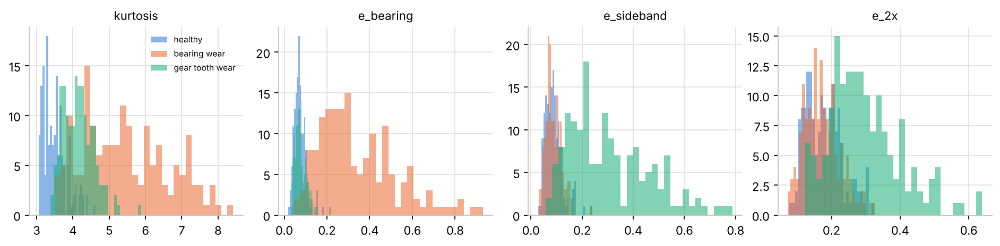
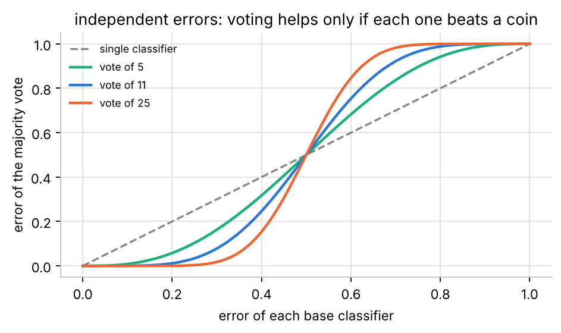
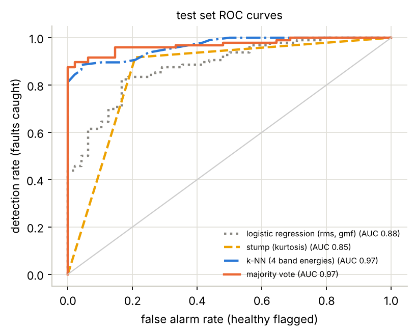
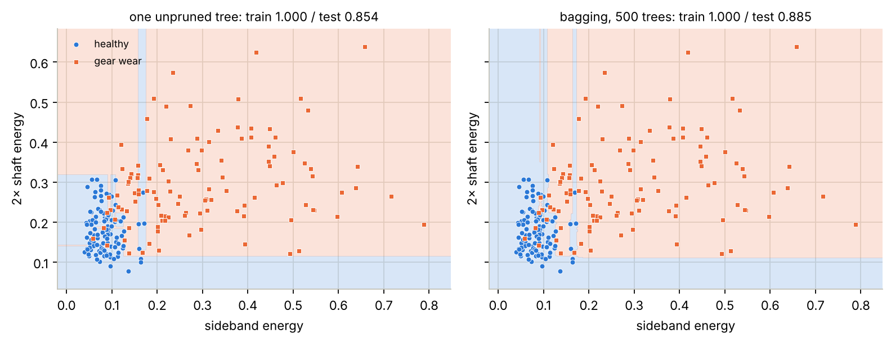
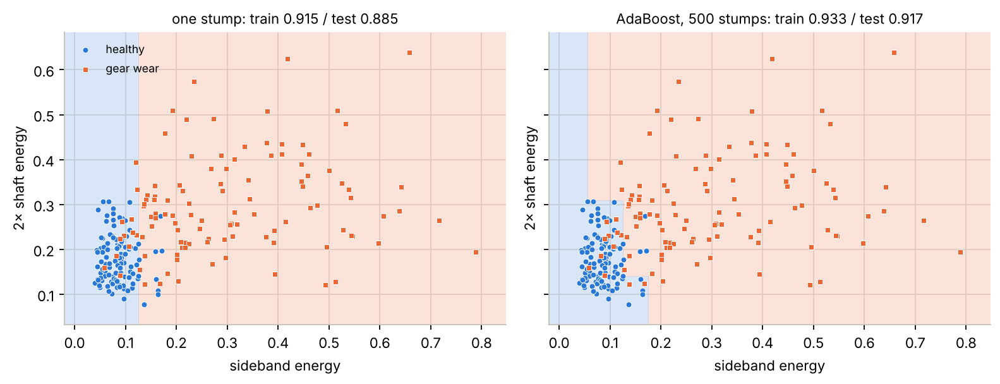
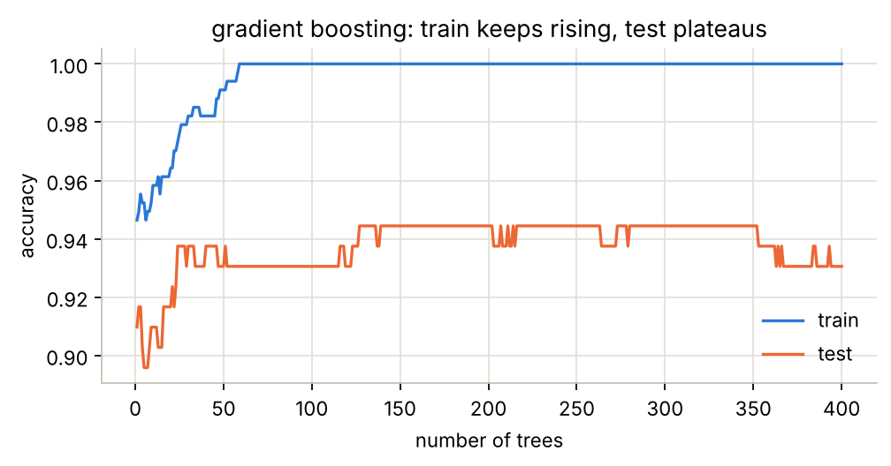
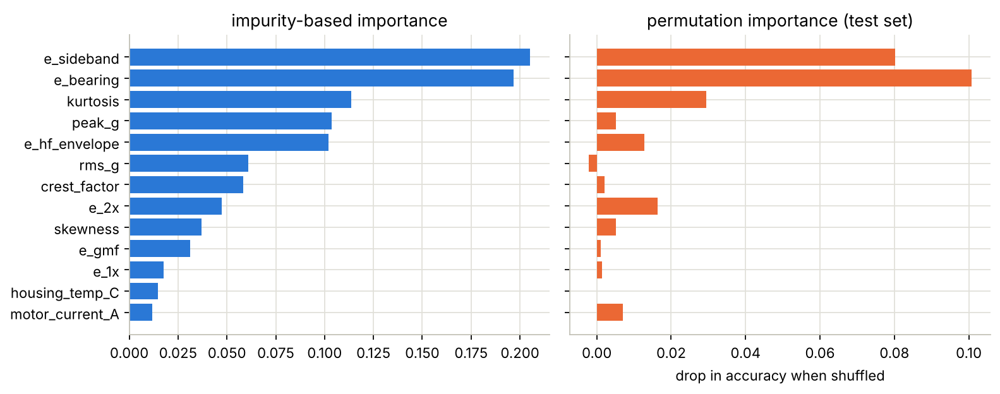
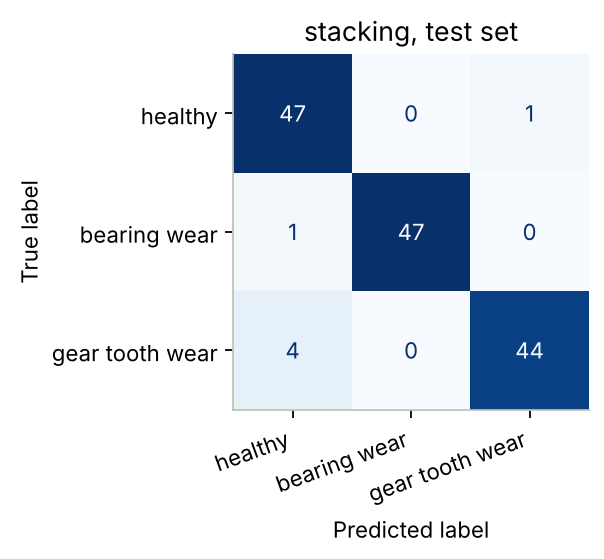

# Chapter 5 — Ensemble Learning: Diagnosing a Robot Wrist Gearbox

> **Companion notebook:** [`ch05_ensembles.ipynb`](ch05_ensembles.ipynb). Every figure and
> number in this chapter comes from it; it needs no download. XGBoost is used if installed;
> otherwise the notebook falls back to scikit-learn's `HistGradientBoostingClassifier`.

## 5.1 The problem

The wrist joints of a 6-axis industrial robot carry compact, heavily loaded gearboxes. When one
fails in production the line stops. The two most common root causes, **bearing outer-race
wear** and **gear tooth wear**, develop over weeks — so there is time to catch them, if you are
looking.

Every night the robot runs a short, identical test move while an accelerometer on the gearbox
housing records two seconds of vibration and the controller logs the drive current. Standard
signal processing reduces each recording to **13 condition indicators**:

| feature | physical meaning | rises with |
|---|---|---|
| `rms_g` | overall vibration level | everything |
| `peak_g`, `crest_factor` | largest spike, and spike / RMS | impacts |
| `kurtosis` | impulsiveness (3 for Gaussian noise) | bearing defects |
| `skewness` | asymmetry of the signal | (weak) |
| `e_1x`, `e_2x` | energy at 1× and 2× shaft speed | imbalance; gear wear |
| `e_gmf` | energy at the gear-mesh frequency | load; gear wear |
| `e_sideband` | sidebands around the mesh frequency | gear tooth damage |
| `e_bearing` | energy at the bearing defect frequency | bearing wear |
| `e_hf_envelope` | high-frequency envelope energy | bearing impacts |
| `motor_current_A` | drive current RMS | load |
| `housing_temp_C` | housing temperature | load × speed; friction |

The task is three-class classification: **healthy, bearing wear, gear tooth wear**.

The simulator that generates the data gives each faulty unit a **severity** between 0 (just
starting) and 1 (severe). Many units are *incipient* — their indicators are barely different
from healthy ones. The night-to-night variation in load and speed of the test move changes every
vibration energy together, which makes the features correlated. There are 160 recordings per
class.

*Figure 5.1 — Each fault raises its own indicators (kurtosis and bearing-band energy for bearing
wear; sideband and 2× energy for gear wear), but every histogram overlaps with "healthy": those
are the incipient faults.*

No single model diagnoses this perfectly. **Ensemble methods** combine many imperfect models into
one that is better than any of them. This chapter explains why that works and covers the
methods used in practice: majority voting, bagging, boosting (AdaBoost and gradient boosting),
random forests and stacking.

## 5.2 Why ensembles work

Suppose $n$ classifiers each have error rate $\varepsilon$ and make their mistakes
**independently**. A majority vote is wrong only when more than half of them are wrong at once:

$$\varepsilon_\text{ens}=\sum_{k=\lceil n/2\rceil}^{n}\binom{n}{k}\varepsilon^k(1-\varepsilon)^{n-k}.$$

For eleven classifiers that are each wrong 25 % of the time, the vote is wrong only 3.4 % of the
time.

*Figure 5.2 — Majority-vote error against the error of each base classifier, assuming independent
errors.*

The formula carries two conditions, and every ensemble method is designed around them:

1. **Each member must beat chance** ($\varepsilon<0.5$). To the right of the crossing point in
   Figure 5.2, voting makes things worse.
2. **The members' errors must be independent** — or at least not identical. Ten copies of one
   model make the same mistakes and gain nothing.

The methods differ in *how they create diversity*: different algorithms or different features
(voting), different bootstrap samples (bagging, random forests), re-weighted samples (AdaBoost),
or models trained on one another's residuals (gradient boosting).

## 5.3 Majority voting

The first question a maintenance planner asks is simply *is this gearbox healthy or not?*, so we
start with that binary task. Three deliberately simple base models each see a different symptom:

* logistic regression on overall level (`rms_g`, `e_gmf`);
* a depth-1 decision tree (a "stump") on `kurtosis`;
* k-NN on four band energies (`e_sideband`, `e_bearing`, `e_2x`, `e_hf_envelope`).

A **soft majority vote** averages their predicted class probabilities and picks the most
probable class:

$$\hat y=\arg\max_k\ \frac1m\sum_{j=1}^m w_j\,P_j(y=k\mid\mathbf x).$$

The notebook implements it as a short `MajorityVoteClassifier` class compatible with
scikit-learn; `sklearn.ensemble.VotingClassifier(voting="soft")` does the same.

| model | 5-fold CV ROC AUC |
|---|---|
| logistic regression (rms, gmf) | 0.906 ± 0.023 |
| stump (kurtosis) | 0.819 ± 0.046 |
| k-NN (4 band energies) | 0.967 ± 0.010 |
| **soft majority vote** | **0.975 ± 0.015** |

*Figure 5.3 — Test-set ROC curves. The vote dominates the low-false-alarm corner.*

The vote beats every member in cross-validation, including the strong k-NN, because each member
sees a different symptom and their mistakes are only partly correlated. On the small test set
it ties k-NN on AUC but dominates the region of few false alarms — which is where a maintenance
planner works, because every false alarm costs a technician's visit. (ROC curves and AUC are
treated fully in Chapter 7.)

## 5.4 Bagging

**Bagging** (bootstrap aggregating) trains the *same* algorithm many times, each time on a
**bootstrap sample** — $n$ samples drawn *with replacement* from the $n$ training samples, so each
bootstrap sample contains roughly 63 % of the distinct training samples, some of them repeated.
The models vote.

Bagging attacks **variance**. An unpruned decision tree fits its training set perfectly and
changes a lot when the training set changes; averaging hundreds of such trees cancels much of
that variability.

To see the effect we use the hardest pair of classes, healthy versus gear wear, and two
features, sideband energy and 2× shaft energy.

*Figure 5.4 — Left: one unpruned tree, a patchwork of thin slivers around individual points
(test accuracy 0.854). Right: 500 bagged trees, a smoother boundary (0.885).*

Both models classify every training sample correctly, but bagging generalises better. Bagging
does **not** reduce bias: bagging a stump still gives a stump-like boundary. For that we need
boosting.

## 5.5 Adaptive boosting (AdaBoost)

Boosting reverses the strategy. It starts from **weak learners** with high bias — typically
stumps — and trains them **sequentially**, each one concentrating on the samples its predecessors
got wrong. For labels $y\in\{-1,+1\}$:

1. Initialise sample weights $w_i=1/n$.
2. For $j=1,\dots,m$:
   * fit weak learner $C_j$ to the weighted data; call its predictions $\hat y_i$;
   * compute the weighted error $\varepsilon_j=\sum_i w_i\,[\hat y_i\ne y_i]$;
   * compute the learner's weight $\alpha_j=\tfrac12\ln\dfrac{1-\varepsilon_j}{\varepsilon_j}$;
   * update $w_i\leftarrow w_i\exp(-\alpha_j\hat y_iy_i)$ and normalise to sum to 1.
3. Predict with $\operatorname{sign}\big(\sum_j\alpha_jC_j(\mathbf x)\big)$.

### One round by hand

Ten nightly recordings, one feature (sideband energy), and the stump "gear wear if sideband >
0.15". The stump misclassifies two recordings: an incipient gear fault at 0.13 and a healthy unit
at 0.16. With equal starting weights of 0.1:

* weighted error $\varepsilon=0.2$, so $\alpha=\tfrac12\ln(0.8/0.2)=0.693$;
* each misclassified recording's weight is multiplied by $e^{0.693}=2$, each correct one's by
  $e^{-0.693}=0.5$;
* after normalisation the two misclassified recordings weigh **0.25 each** and the eight correct
  ones **0.0625 each**.

The two hard cases now carry as much total weight as the other eight together, so the next stump
is forced to deal with them.

### AdaBoost in scikit-learn

*Figure 5.5 — Left: one stump draws a single vertical line (test accuracy 0.885). Right: 500
boosted stumps draw a staircase using both features (0.917).*

A stump can draw only one axis-parallel line. AdaBoost's weighted sum of 500 stumps draws a
boundary that uses both features — lower bias than a stump, and here better test accuracy than
both the single stump and the bagged trees. The `learning_rate` parameter shrinks each
$\alpha_j$; smaller values need more learners but usually generalise better.

## 5.6 Gradient boosting and XGBoost

**Gradient boosting** also builds trees sequentially, but rather than re-weighting samples, each
new tree is fitted to the **negative gradient of the loss** with respect to the current model's
output. For squared error the negative gradient is simply the residual, so each tree literally
predicts what the ensemble so far got wrong. After $m$ trees

$$F_m(\mathbf x)=F_{m-1}(\mathbf x)+\eta\,h_m(\mathbf x),$$

where $h_m$ is a small tree (depth 2–6) and $\eta$ the learning rate, or *shrinkage*. For
classification the trees fit gradients of the log-loss on the log-odds scale.

From here on we use the full three-class problem and all 13 features.

*Figure 5.6 — Training accuracy keeps rising as trees are added; test accuracy plateaus after
roughly 100 trees.*

The gap in Figure 5.6 is the reason gradient boosting needs care: given enough trees it will
memorise the training set. The levers are the number of trees (or early stopping on a validation
set), the learning rate, tree depth, and `subsample` < 1, which trains each tree on a random
subset of the data (*stochastic* gradient boosting).

**XGBoost** is an optimised implementation of gradient boosting with built-in L1/L2
regularisation of the leaf values, fast histogram-based split finding, column subsampling and
good defaults. It and its relatives (LightGBM, CatBoost, scikit-learn's
`HistGradientBoostingClassifier`) are the standard first choice for tabular industrial data.

## 5.7 Random forests and feature importance

A **random forest** is bagging of deep decision trees with one extra source of diversity: at each
split, a tree may choose only among a **random subset of the features** (by default $\sqrt{m}$ of
them). This stops every tree from splitting on the same dominant feature and de-correlates their
errors. Random forests have few hyperparameters, rarely overfit badly as trees are added, and need
no feature scaling — which makes them a robust default.

A forest can also report which features it relied on:

* **impurity-based importance** sums, for each feature, the impurity decrease of every split that
  used it, averaged over the trees. It is free to compute but biased toward features with many
  distinct values and toward one of a group of correlated features;
* **permutation importance** shuffles one feature in the *test* set and measures the drop in
  accuracy. It is slower but measures what the model actually uses on new data.

*Figure 5.7 — Impurity-based (left) and permutation (right) importance of the 13 indicators.*

The forest has rediscovered vibration-analysis practice: **bearing-band energy** and **sideband
energy** — the first two indicators a vibration analyst checks — come out on top, followed by the
impulsiveness family (kurtosis, peak, HF envelope, crest factor). Current and temperature, which
follow the load of the test move rather than the fault, rank low.

The two panels disagree in detail, and the disagreement is instructive. Kurtosis, peak and crest
factor carry nearly the same information; shuffling any one of them costs little because the
forest can use the others. A low permutation importance therefore does **not** mean a sensor is
useless — only that its information is available elsewhere. Think twice before removing hardware
on that evidence.

## 5.8 Stacking, and the comparison

**Stacking** trains a **meta-learner** on the predictions of several base models. If the
meta-learner were trained on predictions the base models made for their own training data, it
would learn to trust overfitted models; scikit-learn's `StackingClassifier` avoids this by feeding
it **out-of-fold** predictions from an internal cross-validation.

The notebook compares every method on the three-class problem with 5-fold cross-validation on the
training set and a final check on the test set:

| model | CV accuracy | CV std | test accuracy |
|---|---|---|---|
| decision tree | 0.887 | 0.031 | 0.847 |
| logistic regression | 0.928 | 0.020 | 0.958 |
| RBF SVM | 0.923 | 0.017 | 0.944 |
| bagging (500 trees) | 0.902 | 0.022 | 0.917 |
| AdaBoost (stumps) | 0.902 | 0.026 | 0.924 |
| gradient boosting | 0.914 | 0.024 | 0.944 |
| XGBoost | 0.923 | 0.026 | 0.931 |
| random forest | 0.917 | 0.018 | 0.931 |
| soft vote (LR, SVM, RF) | 0.926 | 0.016 | 0.951 |
| stacking (LR, SVM, RF → LR) | 0.920 | 0.015 | 0.958 |

*Figure 5.8 — Confusion matrix of the stacked model on the test set. Five of its six errors are faulty gearboxes called healthy.*

Read the table with the cross-validation spread in mind: differences of one or two percentage
points between the good models are within noise for a data set of this size. The robust
conclusions are:

* **Every ensemble beats a single unpruned tree**, in cross-validation and on the test set.
* **On well-engineered features a regularised linear model is already competitive.** Ensembles
  add little on top here. They earn their keep when features are many, raw, or interact in ways
  nobody engineered by hand.
* **The remaining errors are mostly incipient faults labelled healthy.** No algorithm can detect a
  fault that has not yet changed the signal. The way forward is a better sensor, or a model that
  follows the *trend* over several nights (Chapter 11) — not a larger ensemble.

## Summary

| method | how members are trained | mainly reduces | typical base learner |
|---|---|---|---|
| majority vote | different models, in parallel | variance (if errors differ) | any |
| bagging | same model on bootstrap samples, in parallel | variance | deep trees |
| random forest | bagging + random feature subsets at each split | variance | deep trees |
| AdaBoost | sequentially, re-weighting misclassified samples | bias | stumps |
| gradient boosting / XGBoost | sequentially, fitting the loss gradient | bias (variance via shrinkage, subsampling) | shallow trees |
| stacking | meta-model on out-of-fold predictions | both | any |

## Exercises

1. Make the three voting members less diverse by giving all of them the same two features. How
   much of the vote's advantage remains? Relate the result to the independence assumption.
2. Plot bagging test accuracy against `n_estimators` = 1, 5, 25, 100, 500. Where does it stop
   improving?
3. Rerun the AdaBoost example with `learning_rate=1.0`. What happens to the boundary and the test
   accuracy?
4. Remove the four features with the lowest permutation importance and retrain the random forest.
   Does accuracy change? Would you remove those sensors from the robot?
5. Modify the generator to return each unit's fault severity, and compute the detection rate for
   faults with severity below 0.3. What does that number tell the maintenance planner?
