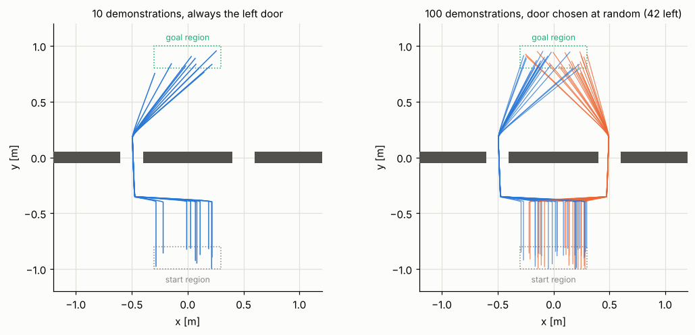
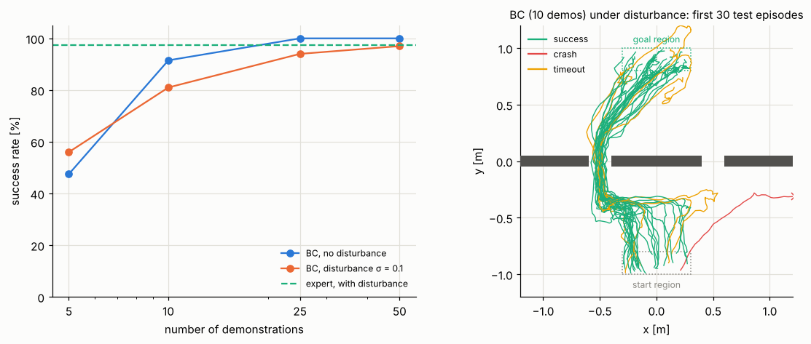
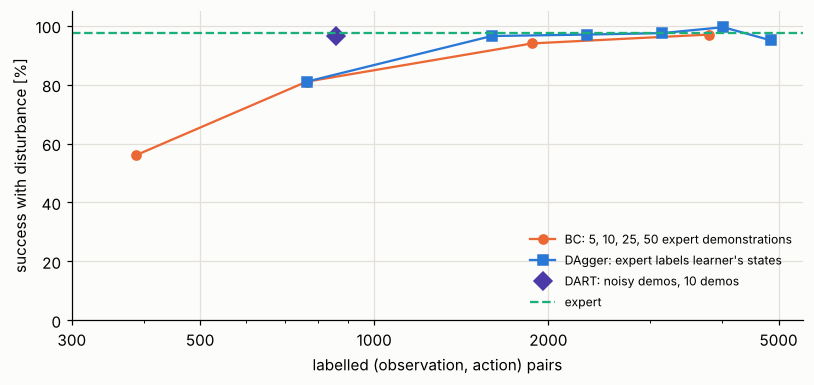
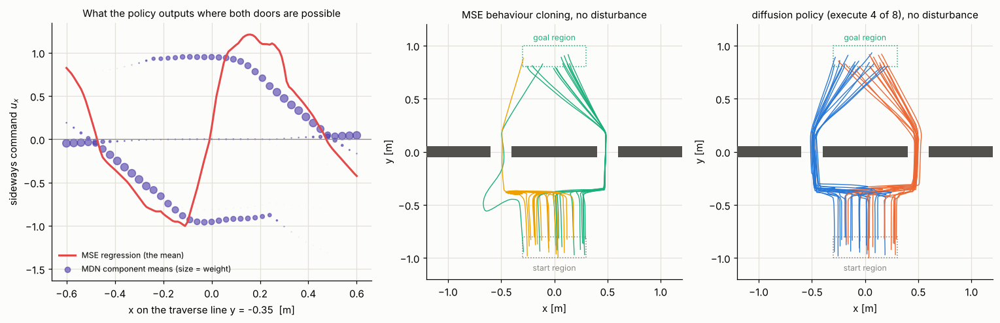
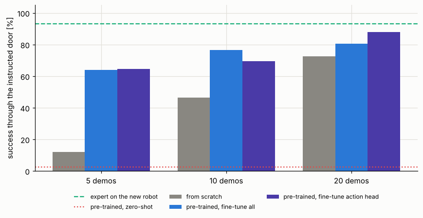

# Chapter 15b. Imitation Learning and Robot Foundation Models

*Part IV. Learning to act*

> **Case study:** a gantry that must thread one of two doors, learned only from demonstrations, then re-targeted to a second robot from five demonstrations
> **Companion notebook:** [`book/notebooks/mlpi26_IL_nb1.ipynb`](../notebooks/mlpi26_IL_nb1.ipynb) (the whole chapter, measured; about 5.5 minutes on a CPU, no downloads)
> **Built from:** new material for the outline's imitation-learning gap chapter (no lecture covers it yet)
> **Number:** provisional. The outline puts this chapter in Part IV; "15b" places it after Chapter 15 and before Chapter 16 without renumbering the chapters already drafted.

Chapters 13 and 14 taught a robot to act from a *reward*. This chapter teaches it to act from *demonstrations*, which is how most manipulation policies in industry and research are trained today, including the large vision-language-action models. Chapter 16 (deployment and sim-to-real) then applies to both.

## Learning objectives

After this chapter you should be able to

1. formulate imitation learning as supervised learning and train a behaviour-cloning policy in PyTorch;
2. explain compounding error and distribution shift, and why they grow with task length;
3. recognise causal confusion, where a lower training loss produces a worse robot;
4. fix distribution shift with interactive data collection (DAgger) or noise injection (DART);
5. explain why mean-squared-error regression fails on multimodal demonstrations, and choose a
   distributional policy (mixture density network, diffusion policy) with action chunking;
6. describe the architecture, data and training recipe of vision-language-action (VLA) robot
   foundation models, and adapt a pre-trained policy to a new robot with a few demonstrations.

---

## 15b.1 Why imitate?

Chapter 14 taught a quadrotor to hover with reinforcement learning. That needed two things a factory
rarely has. First, a **reward function** that captures the task: for hovering, "stay near the set
point, upright and calm" is easy to write. For "insert this connector", "route this cable into the
clip" or "pick the part and place it in the fixture", writing a reward that cannot be gamed is about
as hard as writing the controller. Second, **millions of trials**, which only a simulator can supply,
and the simulator must be good enough for the policy to transfer.

Imitation learning (IL) asks for something cheaper: **show the robot what to do.** An operator drives
the robot through the task with a teleoperation rig — a kinematically matched leader arm, a 3-D
mouse, a VR controller, or kinesthetic teaching by hand — and we record what the robot *observed*
(camera images, joint angles, forces) and what the operator *commanded*. A policy is then trained to
reproduce the operator.

| | reinforcement learning (Ch. 13–14) | imitation learning (this chapter) |
|---|---|---|
| supervision | a scalar reward | expert actions |
| data | the robot's own trials | demonstrations, usually teleoperated |
| typical amount | 10⁵–10⁸ steps, in simulation | 10–1000 demonstrations, on the real robot |
| can exceed the teacher? | yes | not by itself |
| characteristic failure | reward hacking, sample cost | distribution shift, ambiguous demonstrations |

The two are complementary rather than rivals. Many recent systems pre-train by imitation and then
improve with RL, and RL policies trained in simulation are sometimes *distilled* into a vision-based
policy by imitation.

The first imitation-learned robot policy predates deep learning. **ALVINN** (Pomerleau, 1989) steered a
van from a 30 × 32 camera image with a three-layer network trained to copy a human driver. Pomerleau
immediately ran into the central difficulty of this chapter: the human always drove in the middle of
the lane, so the network had never seen what to do when it drifted off-centre. His fix — synthesising
shifted views with corrective steering labels — is an early form of the recovery data we meet in
§15b.4.

### Terminology

| term | meaning |
|---|---|
| demonstration (episode, trajectory) | one recorded execution of the task: $(o_0,a_0,o_1,a_1,\dots,o_T)$ |
| expert, demonstrator | whoever produced the demonstrations: a human operator, a planner, or another policy |
| observation $o_t$ | what the policy receives (images, proprioception, goal) |
| action $a_t$ | what the policy outputs (joint or end-effector velocity, target pose, gripper command) |
| policy $\pi_\theta(a\mid o)$ | the learned mapping, deterministic or a distribution |
| behaviour cloning (BC) | fit $\pi_\theta$ to the demonstrations by supervised learning |
| rollout | running the policy in closed loop on the robot or simulator |

---

## 15b.2 The running example: threading a door

One small task carries the chapter. A planar end-effector — a Cartesian gantry, or an arm under
task-space velocity control — starts below a wall and must reach a goal above it, passing through one
of two 20 cm doors in a 10 cm thick wall (Figure 15b.1).

| design choice | value | why |
|---|---|---|
| state | position $p=(x,y)$, velocity $v$, goal $g$ | a 2-D end-effector |
| action | $u\in[-1,1]^2$; commanded velocity $v_\text{max}Ru$, $v_\text{max}$ = 0.5 m/s | velocity control; $R$ is the robot's mounting rotation (identity until §15b.6) |
| servo | $v_{t+1} = v_t + \tfrac{\Delta t}{\tau}(v_\text{cmd}-v_t)$, $\tau$ = 0.2 s, $\Delta t$ = 0.1 s | the axis lags the command |
| disturbance | velocity noise σ = 0.1 m/s per step, at test time | vibration, slip, a bump |
| observation | $p$, $g-p$, the two door positions | 6 numbers; no velocity (see §15b.3.3) |
| success | within 6 cm of the goal in 12 s, never touching the wall | |

The **expert** is a scripted controller with the "safe-height" motion familiar from pick-and-place:
rise to a traverse line at $y=-0.35$ m, move sideways until under the chosen door, go straight up
through it, then head for the goal. It succeeds in 100.0 % of test episodes without
disturbance and 97.5 % with it, because it is a feedback controller and corrects drift. Two
properties of this expert are important later: it is a function of the state *and of the door it has
chosen*, so (i) it can label **any** state, which DAgger needs, and (ii) if the door is chosen at
random the demonstrations are **multimodal**.



*Figure 15b.1 — Demonstrations. Left: 10 demonstrations that always use the left door (764
observation–action pairs). Right: 40 of 100 demonstrations in which the door is chosen at random
(blue left, orange right; 42 of the 100 went left).*

A real cell would use camera images rather than six clean numbers, and the action might be a 7-DoF
arm velocity. The phenomena below — compounding error, causal confusion, multimodality, the value of
pre-training — are the same; a small task lets us measure each one in seconds on a CPU.

---

## 15b.3 Behaviour cloning

### 15b.3.1 Imitation as regression

Behaviour cloning treats the demonstrations $\mathcal D = \{(o_i,a_i)\}$ as an ordinary supervised data
set and fits a deterministic policy by least squares:

$$\min_\theta\;\frac{1}{|\mathcal D|}\sum_{(o,a)\in\mathcal D}\big\|\pi_\theta(o)-a\big\|^2 .$$

That is the whole algorithm. In PyTorch it is the training loop of Chapter 8 with different labels:

```python
X, Y = np.concatenate(O), np.concatenate(A)          # all (observation, action) pairs
norm = Normalizer(X)                                  # standardise with training statistics
net = mlp(X.shape[1], 2, h=128)                       # 2 hidden layers of 128 ReLU units
opt = torch.optim.Adam(net.parameters(), lr=1e-3)
for it in range(steps):
    idx = torch.randint(0, len(X), (256,))
    loss = F.mse_loss(net(Xt[idx]), Yt[idx])
    opt.zero_grad(); loss.backward(); opt.step()
```

Everything you know about supervised learning applies — normalisation, a validation split, early
stopping — with one exception that dominates the rest of the chapter: **the test inputs are produced
by the policy itself.**

### 15b.3.2 Compounding error

We train on 5, 10, 25 and 50 left-door demonstrations and test on 200 new start/goal pairs, without and
with the test-time disturbance.

| demonstrations | success, no disturbance | success, disturbance | crash | time-out |
|---|---|---|---|---|
| 5  | 47.5 % | 56.0 % | 11.0 % | 33.0 % |
| 10 | 91.5 % | 81.0 % | 8.5 % | 10.5 % |
| 25 | 100.0 % | 94.0 % | 0.5 % | 5.5 % |
| 50 | 100.0 % | 97.0 % | 1.0 % | 2.0 % |
| expert | 100.0 % | 97.5 % | | |



*Figure 15b.2 — Left: behaviour-cloning success against the number of demonstrations. Right: 30 test
episodes of the 10-demonstration policy under disturbance; green succeeded, red crashed (×), yellow
timed out.*

Two readings of the table:

* **Data helps.** Five demonstrations are not enough even without disturbance (47.5 %); 25 are.
* **Disturbance hurts the learner much more than the expert.** At 10 demonstrations success falls from
  91.5 % to 81.0 %, while the expert loses only 2.5 points. The disturbance pushes the
  learner into states the expert never visited — a little to the side of its path, or below the
  traverse line — and there the network's output is an extrapolation, not a correction. The right panel
  of Figure 15b.2 shows the result: trajectories that drift into the edge of the door.

(At 5 demonstrations the disturbance *raises* success. That policy mostly stalls, and noise
occasionally knocks it out of the stall. A policy rescued by noise is not one to deploy.)

**Why the error compounds.** Let $\varepsilon$ be the probability that the learner's action differs
meaningfully from the expert's, *measured on states drawn from the expert's distribution* — the
quantity supervised learning controls. In closed loop, one mistake moves the robot to a state outside
that distribution, where the error rate is no longer $\varepsilon$ and may stay high until the end of
the episode. Over a horizon of $T$ steps a mistake at step $t$ can cost up to $T-t$ steps, and summing
over $t$ gives the bound of Ross and Bagnell (2010):

$$J(\pi_\theta) \;\le\; J(\pi^*) + O(\varepsilon\,T^2),$$

where $J$ is the expected total cost. A learner trained on *its own* state distribution achieves
$O(\varepsilon T)$. The quadratic dependence explains the engineering folklore: BC is fine for short,
forgiving motions and breaks first on long, precise ones — exactly the door, the connector and the peg.

### 15b.3.3 Lower loss, worse robot: causal confusion

Since the servo lags, position alone does not determine where the robot will go next; the velocity
does. Adding the measured velocity to the observation therefore looks like an obvious improvement. We
train on the same 25 demonstrations with and without it:

| observation | training MSE | success, no disturbance | success, disturbance |
|---|---|---|---|
| position, goal, doors | 0.0088 | 100.0 % | 94.0 % |
| + measured velocity | 0.00171 | 6.5 % | 2.0 % |

The velocity input lowers the training error about five-fold and destroys the robot. In the
demonstrations the velocity is a smoothed copy of the **previous command**, so "output roughly what
you are already doing" predicts the label very well. The network learns that shortcut instead of the
real cause of the expert's action — where the robot is relative to the door. In closed loop the
shortcut feeds itself: whatever the robot is doing, the policy keeps doing it. It rises straight past
the traverse line into the wall, or keeps sliding sideways past the door.

De Haan et al. (2019) named this **causal confusion**; Wen et al. (2020) the **copycat problem**. It
appears whenever the input contains information that is a consequence of past actions — velocity,
force, a history of frames, or the previous action itself. Two lessons generalise:

1. **Validation loss ranks imitation policies badly.** Always evaluate by rolling the policy out.
2. **Be suspicious of inputs that leak the previous action.** Remedies include dropping or noising
   them during training, predicting chunks of future actions (§15b.5.3) rather than one, and
   up-weighting samples where the expert *changed* its action.

---

## 15b.4 Fixing distribution shift: DAgger and DART

Behaviour cloning learns from the states the **expert** visits; the robot is evaluated on the states the
**learner** visits. The cure is to collect labels on the learner's states.

**DAgger** (Dataset Aggregation; Ross, Gordon and Bagnell, 2011):

> 1. Train $\pi_1$ by behaviour cloning on the demonstrations $\mathcal D$.
> 2. For $i = 1,2,\dots$: run $\pi_i$ and record the states it visits; ask the expert to label each
>    of those states with the action *it* would have taken; add the pairs to $\mathcal D$; train
>    $\pi_{i+1}$ on all of $\mathcal D$.

After a few rounds the data covers the learner's own mistakes, and the cost bound becomes linear in
$T$. The practical catch is the labelling step: the expert must say what to do in states it did not
produce. With a scripted or planning expert, as here, that is free. With a human it is awkward to
label states after the fact, so practice uses **interventions**: the operator watches the robot and
takes over when it drifts, and the take-over segments are added to the data (HG-DAgger; Kelly et al.,
2019).

**DART** (Laskey et al., 2017) avoids interaction altogether: while the expert demonstrates, inject
noise into the *executed* command but record the expert's *intended* action. The expert's corrections
to the noise are then in the data from the start. On a real robot this can be as simple as adding a
random offset to the teleoperation command.



*Figure 15b.3 — Success under disturbance against the number of labelled pairs. More clean
demonstrations (orange) versus DAgger from 10 demonstrations (blue) and DART with 10 noisy
demonstrations (violet).*

One round of DAgger — ten learner roll-outs relabelled by the expert — lifts the 10-demonstration
policy from 81.0 % to 96.5 % under disturbance, using 1,596 labelled pairs. Plain BC needs about
25 demonstrations to reach a similar level (94.0 %). DART reaches 96.5 % from the same 10
demonstrations recorded under noise (860 pairs) without a single extra expert query. Later
DAgger rounds fluctuate between 95.0 % and 99.5 %; with 200 test episodes the standard error of a
success rate near 96 % is about 1.4 points, so those differences are noise, not trend.

The lesson is about **where** data comes from, not only how much. More demonstrations of the same
clean behaviour eventually work on this easy task (50 demonstrations: 97.0 %), but recovery
data is far cheaper, and on harder tasks clean data may never cover the states that matter.

---

## 15b.5 Multimodal demonstrations

### 15b.5.1 The mean of two good answers is a bad answer

Now train on the 100 demonstrations in which the operator chose a door at random. From the start
region both "go left" and "go right" are correct. Behaviour cloning with MSE succeeds in only
41.5 % of episodes without disturbance, and the rest are time-outs (58.5 %): the robot
rises to the traverse line and then hesitates there.

The minimiser of expected squared error is the **conditional mean**,
$\pi^*_\text{MSE}(o) = \mathbb E[a\mid o]$. Where half the demonstrations say "left at full speed" and
half say "right at full speed", the mean says "stand still" (Figure 15b.4, left, red curve). In
higher-dimensional tasks the average of two valid grasps is often a grasp *between* two objects, and the
average of "go round the obstacle on the left" and "on the right" goes *through* it.

Multimodality is the rule, not the exception, in real demonstration data: several operators have
different habits; one operator is inconsistent; and many tasks genuinely have several solutions
(which object to pick first, which hand to use). The cure is to model the whole conditional
**distribution** $p(a\mid o)$ and **sample** from it.

### 15b.5.2 Mixture density networks

A mixture density network (MDN; Bishop, 1994) outputs the parameters of a $K$-component Gaussian
mixture and is trained by maximum likelihood:

$$\pi_\theta(a\mid o)=\sum_{k=1}^{K} w_k(o)\,\mathcal N\!\big(a;\mu_k(o),\operatorname{diag}\sigma_k^2(o)\big),\qquad
\mathcal L(\theta) = -\frac{1}{|\mathcal D|}\sum_{(o,a)\in\mathcal D}\log\pi_\theta(a\mid o).$$

The network is the BC network with a wider output layer ($K(2d+1)$ numbers for a $d$-dimensional
action); the loss uses `torch.logsumexp` over components for numerical stability. At run time we
choose a component with probability $w_k$ and sample from it.

With $K$ = 5 the MDN removes the stall: 98.5 % success without disturbance. The left panel of
Figure 15b.4 shows why: on the traverse line it keeps one component pointing left and one pointing
right, and shifts their weights as the robot moves. But it re-samples the mode at **every** step, and
on the traverse line the observation does not say which way the robot was already going (we removed
velocity in §15b.3.3). The result is hesitation — 4.16 left/right reversals per episode on the
traverse line — and under disturbance success falls to 77.5 %.

### 15b.5.3 Diffusion policy and action chunking

**Diffusion Policy** (Chi et al., 2023) makes two changes, and both matter.

**A diffusion model for the action distribution.** A denoising diffusion probabilistic model (DDPM; Ho
et al., 2020) defines a fixed process that gradually adds Gaussian noise to a clean sample $a^0$ over
$K$ steps,

$$a^k = \sqrt{\bar\alpha_k}\,a^0 + \sqrt{1-\bar\alpha_k}\,\epsilon,\qquad \epsilon\sim\mathcal N(0,I),$$

and trains a network $\epsilon_\theta(a^k,k,o)$ to predict the noise that was added:

$$\min_\theta\;\mathbb E_{(o,a^0)\sim\mathcal D,\;k,\;\epsilon}\big\|\epsilon_\theta(a^k,k,o)-\epsilon\big\|^2 .$$

To act, start from pure noise $a^K\sim\mathcal N(0,I)$ and apply the learned denoising step $K$ times,
conditioned on the current observation. The loss is still an MSE, but on the *noise*, so the model
does not average modes: each sampling run ends in one of them. Diffusion models represent arbitrary
multimodal distributions in high dimensions, which is why they took over image generation and then
robot policies. Our implementation is about 40 lines: a 3-layer MLP denoiser with a learned embedding
of $k$, a cosine noise schedule (Nichol and Dhariwal, 2021) and $K$ = 50.

**Predict a chunk of actions.** Instead of one action, the model generates the next $H$ = 8 actions
(0.8 s) as a single 16-dimensional sample, and the robot executes the first $n_\text{exec}$ of them
before sampling again — receding-horizon control, as in MPC. A chunk is a commitment: one sample
contains one consistent route, so the policy cannot change its mind every 0.1 s. Action chunking was
introduced for robot imitation by ACT (Action Chunking with Transformers; Zhao et al., 2023), which
also argued that it reduces compounding error by shortening the effective decision horizon by a factor
$H$, and mitigates causal confusion because the network must predict actions it has not yet taken.

| policy | success, no disturbance | success, disturbance | reversals on traverse line |
|---|---|---|---|
| MSE behaviour cloning | 41.5 % | 82.5 % | — |
| MDN, re-sampled every step | 98.5 % | 77.5 % | 4.16 |
| diffusion, execute 1 of 8 | 100.0 % | 88.0 % | 3.04 |
| diffusion, execute 4 of 8 | 100.0 % | 90.0 % | 1.32 |
| diffusion, execute 8 of 8 | 100.0 % | 77.0 % | 0.56 |

*(MSE and MDN: 200 test episodes. Diffusion: 100 per setting, because each decision costs 50 network
evaluations; standard error about 3 points.)*



*Figure 15b.4 — Left: the sideways command on the traverse line. MSE regression (red) passes through
zero between the doors; the MDN keeps separate left and right components (marker size = mixture
weight). Middle: MSE behaviour cloning stalls on the traverse line (yellow = time-out). Right: the
diffusion policy, executing 4 of 8 actions, commits to one door per episode (blue left, orange right).*

Three conclusions:

* **Every distributional policy solves the clean task; MSE regression does not.**
* **Longer execution means less hesitation.** Reversals fall from 3.04 to 1.32 to 0.56
  as the robot commits to more of each chunk.
* **Open-loop execution cannot react.** Executing the whole chunk gives the worst result under
  disturbance (77.0 %, 18.0 % crashes): 0.8 s of drift next to a wall goes uncorrected.
  Executing half a chunk balances commitment and feedback (90.0 %). ACT handles the same
  trade-off with *temporal ensembling*, averaging the overlapping predictions of successive chunks.

**Other distributional heads.** Discretising each action dimension into bins and predicting a
categorical distribution (as language models predict tokens) is simple and multimodal; it is what
RT-1, RT-2 and OpenVLA do. Behaviour Transformers (Shafiullah et al., 2022) combine k-means action bins
with a continuous offset. Implicit BC (Florence et al., 2021) learns an energy function and optimises
it at run time. Flow matching (Lipman et al., 2023), a close relative of diffusion that needs fewer
integration steps, is used by π0. All of them answer the same question: *how do I represent
$p(a\mid o)$ when it has several peaks?*

---

## 15b.6 From one task to many: robot foundation models

### 15b.6.1 Conditioning: tell the robot which mode you want

Sampling a mode at random is acceptable only when any mode will do. Usually the operator *means* a
particular door, part or bin, and the policy must be told. The general fix is to add the
disambiguating information to the input — a goal pose, a goal image, or an instruction in words.

We train one policy on 300 demonstrations across **random layouts** (one door anywhere in
$[-0.85,-0.25]$ m, the other in $[0.25,0.85]$ m), each paired with one of two instructions: *"go through
the left door"* or *"go through the right door"*. The instruction is a token mapped to a learned 16-D
embedding — in a real model it would come from a pretrained language model — and concatenated with
the observation. The demonstrations are recorded with DART noise (§15b.4). On 200 **held-out** layouts,
with disturbance:

| policy | reaches the goal | through the instructed door |
|---|---|---|
| instruction-conditioned | 98.5 % | 98.5 % |
| same data, instruction removed | 90.5 % | 47.0 % |

Without the instruction the policy still reaches the goal — it has learned to break ties — but uses the
requested door only at chance level. Note also that conditioning **removes the multimodality**: given
the instruction, the demonstrations are unimodal again, and plain MSE regression is adequate. Large
models need distributional heads because, even with an instruction, many details of *how* to do a
task remain ambiguous.

### 15b.6.2 A new robot: pre-train, then fine-tune

Now the policy must run on a **different robot**: its base is mounted rotated by 40°, so every command
is interpreted in a rotated frame, and its axes are slower ($v_\text{max}$ = 0.45 m/s, $\tau$ = 0.25 s).
This is the *cross-embodiment* problem in miniature. We have 5, 10 or 20 demonstrations on the new
robot and compare:

* **from scratch** — a fresh policy trained only on the new demonstrations;
* **fine-tune all** — start from the pre-trained policy and update every weight at a lower learning rate;
* **fine-tune the action head** — freeze the trunk and the instruction embedding and re-train only the
  final linear layer.

| new-robot demonstrations | from scratch | fine-tune all | fine-tune action head |
|---|---|---|---|
| 0 (zero-shot) | — | 2.5 % | 2.5 % |
| 5  | 12.0 % | 64.0 % | 64.5 % |
| 10 | 46.5 % | 76.5 % | 69.5 % |
| 20 | 72.5 % | 80.5 % | 88.0 % |
| expert on the new robot | 93.0 % | | |



*Figure 15b.5 — Success through the instructed door on the new robot (held-out layouts, with
disturbance).*

* **Zero-shot transfer fails** (2.5 %). A 40° rotation of the action frame cannot be inferred
  from observations that do not reveal it.
* **Pre-training pays off most when new data is scarcest.** With 5 demonstrations, fine-tuning reaches
  64.0 %–64.5 % against 12.0 % from scratch. With 20, training from scratch catches
  up partly (72.5 %), but the fine-tuned head is still better (88.0 %).
* **Re-training only the head works** because the trunk already encodes *where the doors are and which
  one was requested*; only the mapping to this robot's commands changed. This is the logic behind
  embodiment-specific action heads and parameter-efficient fine-tuning in real VLAs.

### 15b.6.3 Vision-language-action models

A **robot foundation model** applies the same recipe — pre-train one policy on diverse data, condition
it on instructions, fine-tune for a target robot and task — at a scale four to six orders of magnitude
larger. Most current systems are **vision-language-action models (VLAs)**:

```
 camera images ─┐
                ├─► vision encoder ─┐
 instruction  ──┴─► text tokens ────┼─► pretrained vision-language model ─► action head ─► action chunk
 joint angles ──────────────────────┘        (0.5–7 B parameters)        (tokens, diffusion,
                                                                           or flow matching)
```

| this chapter's toy | a VLA |
|---|---|
| 6 numbers of state | one to three camera images + joint angles |
| instruction token, 16-D embedding | free text through a pretrained language model |
| 2 × 128 MLP trunk | a vision-language model pretrained on web images and text |
| MDN / diffusion on an 8-step chunk | discrete action tokens, or a diffusion / flow-matching action expert on 10–50-step chunks |
| 300 demonstrations, one robot | 10⁵–10⁶ teleoperated episodes from tens of robot types |
| fine-tune a head on 5–20 demonstrations | fine-tune (often with LoRA) on 50–500 demonstrations of the new task or robot |

Why start from a vision-language model? Because web pre-training already supplies object recognition,
spatial language ("the red cup *behind* the box") and some common sense. RT-2 (Brohan et al., 2023)
showed that a VLM fine-tuned to output actions as text tokens could follow instructions involving
objects and concepts never seen in robot data. The action head is where the ideas of §15b.5 return:
RT-2 and OpenVLA discretise each action dimension into 256 bins and predict tokens; π0 (Black et al.,
2024) adds a separate *action expert* that generates 50-step action chunks by flow matching, which is
faster and more precise for dexterous tasks.

The **data** problem is attacked by pooling. Open X-Embodiment (2023) gathered over a million episodes
from 22 robot types in a common format; DROID (Khazatsky et al., 2024) collected 76 k teleoperated
episodes in 564 scenes with one robot model. Cross-embodiment training needs exactly what §15b.6.2
showed in miniature: a shared trunk, and an action representation — or per-robot heads — that can
absorb different kinematics and control frames.

| year | development | why it matters |
|---|---|---|
| 1989 | ALVINN (Pomerleau) | behaviour cloning from camera to steering; distribution shift observed |
| 2011 | DAgger (Ross, Gordon, Bagnell) | interactive data collection, linear error bound |
| 2016 | GAIL (Ho and Ermon) | adversarial imitation: learn a discriminator as reward, then run RL |
| 2022 | RT-1 (Brohan et al.) | transformer policy trained on ~130 k real demonstrations covering 700+ instructions |
| 2023 | ACT / ALOHA (Zhao et al.); Diffusion Policy (Chi et al.) | action chunks and diffusion heads: fine bimanual skills from ~50 demonstrations |
| 2023 | RT-2 (Brohan et al.) | web-pretrained VLM fine-tuned to output action tokens: the first VLA |
| 2023–24 | Open X-Embodiment; DROID | pooled multi-robot data sets |
| 2024 | Octo; OpenVLA (Kim et al.) | open generalist policies; OpenVLA is a 7 B VLA fine-tunable with LoRA |
| 2024 | π0 (Black et al.) | VLM backbone + flow-matching action expert |
| 2025 | π0.5; GR00T N1; Gemini Robotics | open-world generalisation, humanoids, VLAs built on frontier multimodal models |
| 2024–25 | LeRobot, SmolVLA | open tooling: teleoperation, data format, ACT / diffusion / small-VLA training on one GPU |

*This field moves monthly; refresh this table before each offering of the course.*

### 15b.6.4 Using a foundation model in an automation cell

For an engineer the practical question is not how to pre-train a VLA — that costs thousands of GPU-days
— but how to use one. A realistic workflow:

1. **Define the task and its success test** before collecting data: what counts as success, how it is
   measured automatically, and what the cycle-time requirement is.
2. **Set up teleoperation** that matches the deployment observation exactly: same cameras, same
   mounting, same lighting, same control frequency. A leader–follower arm pair (as in ALOHA or the
   LeRobot SO-100 kits) is cheap and produces smooth demonstrations.
3. **Collect 50–200 demonstrations**, varying object positions, lighting and distractors
   deliberately. Include **recovery** behaviour (§15b.4) — start some demonstrations from slightly
   wrong poses, or let the operator correct a running policy.
4. **Train a small specialist first** (ACT or Diffusion Policy). It is often good enough and runs at
   high rate on a modest GPU. Move to fine-tuning a VLA when you need language instructions, many task
   variants, or generalisation to new objects.
5. **Evaluate in closed loop** on held-out object positions, with a fixed protocol and enough trials
   to separate methods (20 trials gives a standard error of about 10 points).
6. **Wrap the learned policy in classical safety**: workspace limits, force/torque thresholds, a
   speed-and-separation monitor and an independent stop, exactly as Chapter 16 describes.

VLAs are large — inference at 5–50 Hz needs a GPU close to the robot — and, like every behaviour-cloned
policy, they can fail confidently in states outside their data. They are a strong starting point, not a
certified controller.

---

## 15b.7 The decisive experiment

For an imitation-learned policy, the decisive experiment is **ranking candidate models by closed-loop roll-outs instead of by validation loss**. In §15b.3.3 the two policies differed only in one input. Validation loss preferred the one with velocity by a factor of five (0.00171 against 0.0088); 200 roll-outs reversed the verdict completely (6.5 % against 100.0 % success). The low-loss model was right for the wrong reason: it predicted the operator's next command from the operator's last one. No held-out split of the demonstrations can catch this, because the shortcut works on every recorded frame; only letting the policy choose its own inputs, by driving the robot, exposes it.

## Summary — what to remember

1. **Imitation learning is supervised learning judged in closed loop.** Validation loss ranks models
   badly; measure success by rolling the policy out, with disturbances.
2. **Expect compounding error** — quadratic in the horizon for plain BC. Long, precise tasks need
   recovery data.
3. **Collect recovery data on purpose**: operator interventions (DAgger) or noise injection while
   demonstrating (DART). It is cheaper than more clean demonstrations.
4. **Beware inputs that leak the previous action** (velocity, action history): causal confusion.
5. **Check demonstrations for multimodality.** MSE averages modes; use a distributional head (MDN,
   discrete tokens, diffusion, flow matching).
6. **Predict action chunks and execute part of each** — commitment without losing feedback.
7. **Condition on what disambiguates the task**: goal, target object, instruction.
8. **Start from a pre-trained policy when one exists**, and fine-tune with the smallest change that
   works (an action head, LoRA) on demonstrations from your own robot.
9. **Report robotics metrics** — success, collision rate, time-outs, hesitation — on held-out
   conditions.

---

## Exercises

**Conceptual**

1. Explain in your own words why the BC error bound is quadratic in $T$ while DAgger's is linear.
   Give an industrial task where $T$ is large and one where it is small.
2. An engineer adds the last five commanded actions to the observation "so the policy knows what it was
   doing", and the validation loss halves. Predict what happens on the robot, and propose two fixes.
3. Two operators demonstrate a bin-picking task: one always picks the left-most part first, the other
   the nearest. What will an MSE policy do? Name two ways to fix it, one through the model and one
   through the input.
4. Why does executing a full action chunk open loop hurt under disturbance, while re-planning every step
   causes hesitation? Relate the trade-off to the prediction horizon in MPC.

**Programming** (start from the companion notebook)

5. **Horizon.** Lengthen the task (goal region at $y\in[1.0,1.15]$, wall at $y=0.2$) and measure the gap
   between BC with and without disturbance.
6. **Causal confusion, fixed.** Keep the velocity input but add Gaussian noise (σ = 0.2 m/s) to it
   during training only. Does closed-loop success recover? Try dropout on that input instead.
7. **A realistic DAgger expert.** Let the expert label only states within 10 cm of its own path and
   discard the rest. How much of DAgger's gain survives?
8. **Mixture size.** Train the MDN with $K$ = 1, 2 and 5. Why is $K$ = 1 equivalent to MSE?
9. **Temporal ensembling.** Re-plan every step but average the overlapping predictions of the last 8
   chunks with exponential weights, as in ACT. Compare success and reversals with $n_\text{exec}$ = 4.
10. **Faster sampling.** Sample the diffusion policy with 10 instead of 50 steps (DDIM; Song et al.,
    2021). Plot success against decision time.
11. **A third instruction.** Add *"use the nearer door"*. What must change in the expert, the data and
    the network? Test on layouts where both doors are almost equally near.
12. **LoRA.** Replace head-only fine-tuning with a rank-2 low-rank update of each trunk layer, and
    compare at 5 demonstrations.

---

## References

* D. A. Pomerleau, "ALVINN: an autonomous land vehicle in a neural network," NeurIPS 1988 (published 1989).
* S. Ross and J. A. Bagnell, "Efficient reductions for imitation learning," AISTATS 2010.
* S. Ross, G. Gordon, J. A. Bagnell, "A reduction of imitation learning and structured prediction to
  no-regret online learning," AISTATS 2011.
* M. Laskey, J. Lee, R. Fox, A. Dragan, K. Goldberg, "DART: noise injection for robust imitation
  learning," CoRL 2017.
* M. Kelly, C. Sidrane, K. Driggs-Campbell, M. J. Kochenderfer, "HG-DAgger: interactive imitation
  learning with human experts," ICRA 2019.
* P. de Haan, D. Jayaraman, S. Levine, "Causal confusion in imitation learning," NeurIPS 2019.
* C. Wen, J. Lin, T. Darrell, D. Jayaraman, Y. Gao, "Fighting copycat agents in behavioral cloning from
  observation histories," NeurIPS 2020.
* C. M. Bishop, "Mixture density networks," Aston University technical report NCRG/94/004, 1994.
* J. Ho and S. Ermon, "Generative adversarial imitation learning," NeurIPS 2016.
* P. Florence et al., "Implicit behavioral cloning," CoRL 2021.
* N. M. Shafiullah, Z. J. Cui, A. Altanzaya, L. Pinto, "Behavior Transformers: cloning k modes with one
  stone," NeurIPS 2022.
* J. Ho, A. Jain, P. Abbeel, "Denoising diffusion probabilistic models," NeurIPS 2020.
* A. Nichol and P. Dhariwal, "Improved denoising diffusion probabilistic models," ICML 2021.
* J. Song, C. Meng, S. Ermon, "Denoising diffusion implicit models," ICLR 2021.
* Y. Lipman, R. T. Q. Chen, H. Ben-Hamu, M. Nickel, M. Le, "Flow matching for generative modeling,"
  ICLR 2023.
* C. Chi et al., "Diffusion Policy: visuomotor policy learning via action diffusion," RSS 2023.
* T. Z. Zhao, V. Kumar, S. Levine, C. Finn, "Learning fine-grained bimanual manipulation with low-cost
  hardware," RSS 2023.
* A. Brohan et al., "RT-1: robotics transformer for real-world control at scale," RSS 2023.
* A. Brohan et al., "RT-2: vision-language-action models transfer web knowledge to robotic control,"
  CoRL 2023.
* Open X-Embodiment Collaboration, "Open X-Embodiment: robotic learning datasets and RT-X models,"
  ICRA 2024.
* A. Khazatsky et al., "DROID: a large-scale in-the-wild robot manipulation dataset," RSS 2024.
* Octo Model Team, "Octo: an open-source generalist robot policy," RSS 2024.
* M. J. Kim et al., "OpenVLA: an open-source vision-language-action model," CoRL 2024.
* K. Black et al., "π0: a vision-language-action flow model for general robot control,"
  arXiv:2410.24164, 2024.
* Physical Intelligence, "π0.5: a vision-language-action model with open-world generalization,"
  arXiv:2504.16054, 2025.
* NVIDIA, "GR00T N1: an open foundation model for generalist humanoid robots," arXiv:2503.14734, 2025.
* Gemini Robotics Team, "Gemini Robotics: bringing AI into the physical world," arXiv:2503.20020, 2025.
* M. Shukor et al., "SmolVLA: a vision-language-action model for affordable and efficient robotics,"
  arXiv:2506.01844, 2025.
* LeRobot documentation: https://huggingface.co/docs/lerobot
