# Chapter 2 — A Tour of Classifiers on a Part-Sorting Conveyor

> **Companion notebook:** [`ch02_classifiers.ipynb`](ch02_classifiers.ipynb). Every figure
> and number in this chapter is produced by it, and the notebook runs without any download.

## 2.1 The problem: which bin does this part go in?

A conveyor carries a random mix of three zinc-plated steel parts: flat washers, hex nuts and
flanged bushings. An inspection station above the belt measures four things about every part:

| feature | meaning | sensor |
|---|---|---|
| `outer_diam_mm` | outer diameter (across corners for the nut) | camera |
| `height_mm` | height of the part lying flat | laser line |
| `hole_ratio` | hole diameter divided by outer diameter | camera |
| `mass_g` | weight | load cell under the belt |

A pneumatic diverter at the end of the station pushes each part into one of three bins. Our job
is to write the rule that turns four measurements into a bin decision.

We could write that rule by hand ("if height < 5 mm it is a washer, …"), and for washers that
works. For nuts and bushings it does not, because their measurements overlap. **Supervised
classification** learns the rule from examples: we collect parts whose type we know, measure
them, and let an algorithm find a rule that reproduces the known labels. A rule that works on
*new* parts — not just on the ones it was trained on — is the goal.

This chapter introduces four classifiers that every engineer using machine learning should
know: **logistic regression**, **support vector machines**, **decision trees** and
**k-nearest neighbours**. They are worth learning together because each one draws a different
*shape* of decision boundary, and the shape is what decides whether a classifier suits a problem.

### The data set

The data is synthetic but built from physics. For each part type the simulator draws an outer
diameter, a height and a hole ratio around the nominal values of that part, then computes the
mass from steel density,

$$m = \rho\,\frac{\pi}{4}\left(D^2 - d^2\right)h,\qquad \rho = 7.85\ \text{g/cm}^3,$$

and adds plating and scale noise. Camera and laser add their own measurement noise. The result
is 450 parts, 150 of each type.

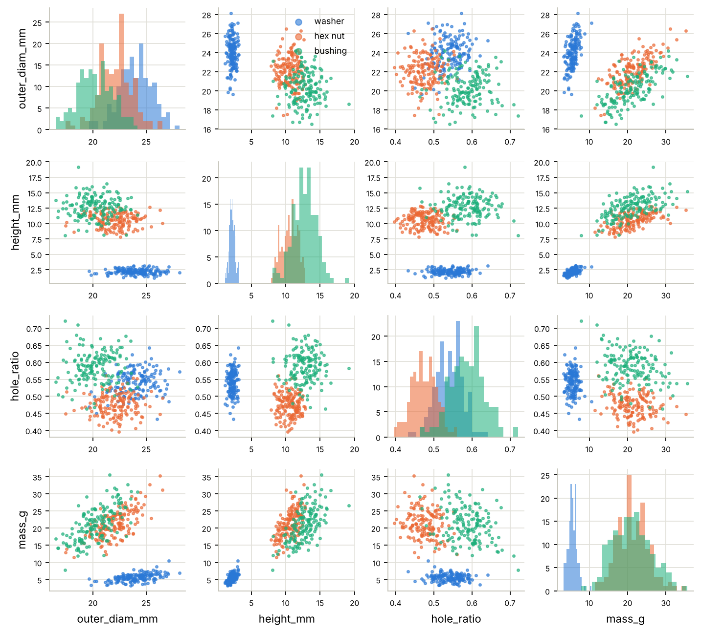

*Figure 2.1 — Every pair of features. Washers (blue) are thin and light and separate from
everything. Nuts (orange) and bushings (green) have nearly the same mass and overlap in height;
they differ most clearly in hole ratio.*

Looking at Figure 2.1 before training anything already tells us the story of the chapter: any
classifier will find the washers; the nut/bushing boundary is where the methods differ.

## 2.2 Preparing the data

Two habits, used in every chapter of this book:

**Split before you look for patterns.** We hold out 30 % of the parts as a **test set** and do
not use it for any decision until the end. `train_test_split(..., stratify=y)` keeps the three
classes in the same proportion in both sets.

**Fit preprocessing on the training set only.** Most classifiers in this chapter need features
on comparable scales. **Standardisation** maps each feature to

$$x'_j = \frac{x_j-\mu_j}{\sigma_j},$$

where $\mu_j$ and $\sigma_j$ are computed **from the training set** and then applied unchanged
to the test set. Computing them on all the data would let information about the test parts leak
into training. On a real cell the scaler you deploy is the one you fitted in the lab, and new
parts will not have mean exactly zero — the notebook shows the test-set means after scaling are
close to, but not exactly, zero.

## 2.3 Logistic regression

### The model

Logistic regression computes a weighted sum of the features, the **net input**
$z=\mathbf w^\top\mathbf x+b$, and passes it through the **logistic sigmoid**

$$\sigma(z)=\frac{1}{1+e^{-z}}.$$

The output lies between 0 and 1 and is interpreted as the probability that the part belongs to
the positive class, $\hat p = P(y=1\mid\mathbf x)$. Predicting class 1 whenever $\hat p\ge 0.5$
is the same as predicting it whenever $z\ge 0$, so the **decision boundary is the hyperplane**
$\mathbf w^\top\mathbf x+b=0$ — a straight line in two dimensions.

### Learning the weights

We choose $\mathbf w$ and $b$ to make the observed labels as likely as possible. Taking the
negative logarithm of the likelihood gives the **log-loss** (binary cross-entropy):

$$L(\mathbf w,b) = -\frac1n\sum_{i=1}^n\Big[y^{(i)}\log\hat p^{(i)}+(1-y^{(i)})\log\big(1-\hat p^{(i)}\big)\Big].$$

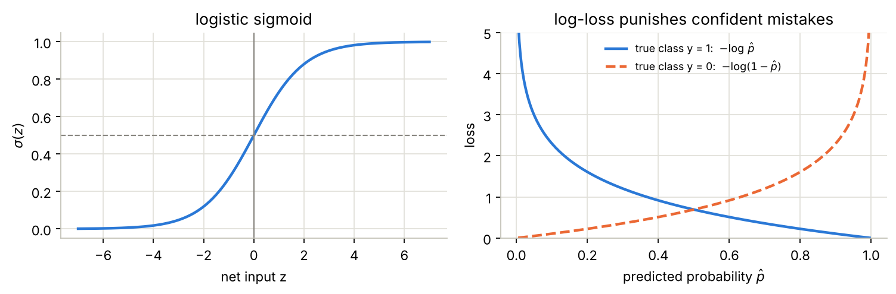

*Figure 2.2 — Left: the sigmoid maps any net input to a probability. Right: the log-loss for
one sample. A confident wrong prediction ($\hat p\to0$ when $y=1$) costs without bound.*

The gradient of the log-loss has a remarkably compact form — prediction error times input —

$$\frac{\partial L}{\partial\mathbf w}=-\frac1n\sum_i\big(y^{(i)}-\hat p^{(i)}\big)\mathbf x^{(i)},\qquad
\frac{\partial L}{\partial b}=-\frac1n\sum_i\big(y^{(i)}-\hat p^{(i)}\big),$$

so **gradient descent**, $\mathbf w\leftarrow\mathbf w-\eta\,\partial L/\partial\mathbf w$, takes
about twenty lines of NumPy. The notebook implements it as `LogisticRegressionGD` and trains it
on the hard sub-problem, nut versus bushing, using height and mass.

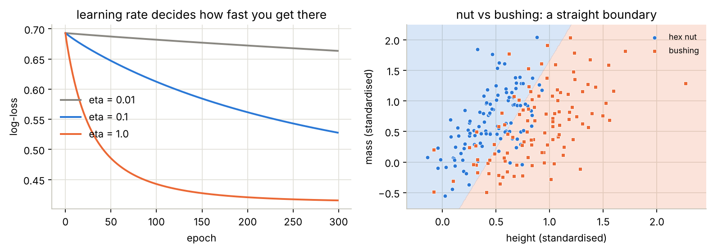

*Figure 2.3 — Left: with learning rate 0.01 the loss barely moves in 300 epochs; with 1.0 it
converges quickly. Right: the learned boundary is a tilted straight line.*

The learned weights are about +6.4 for height and −2.2 for mass (standardised units). Taller
parts are more likely bushings; at a given height a heavier part is more likely the solid hex
nut. Neither feature separates the classes alone, which is why the line is tilted. Train and
test accuracy are both about 81 %: these two features simply overlap.

### Probabilities are useful

A classifier that outputs a probability lets you build a **reject lane**. In the notebook, 28 %
of nut/bushing test parts fall in the band $0.3<\hat p<0.7$. Accuracy on the confident ones is
95 %; on the unsure ones it is 44 % — worse than a coin. Diverting unsure parts to a second
inspection instead of guessing is often worth far more than a better model.

### Three classes, regularisation, and the value of a good feature

scikit-learn's `LogisticRegression` handles more than two classes with the **softmax**
generalisation, one weight vector per class:

$$P(y=k\mid\mathbf x)=\frac{e^{z_k}}{\sum_j e^{z_j}},\qquad z_k=\mathbf w_k^\top\mathbf x+b_k.$$

It also applies **L2 regularisation** by default: it minimises the log-loss plus a penalty
proportional to $\lVert\mathbf w\rVert^2$. The parameter `C` is the *inverse* of the penalty
strength.

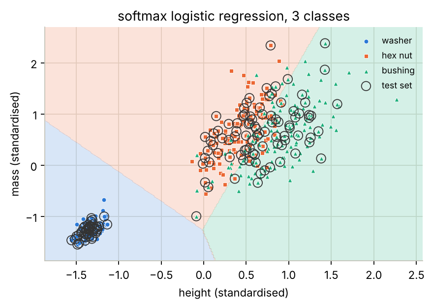

*Figure 2.4 — Softmax logistic regression on height and mass. Circled points are test parts.
Test accuracy with these two features: 0.87.*

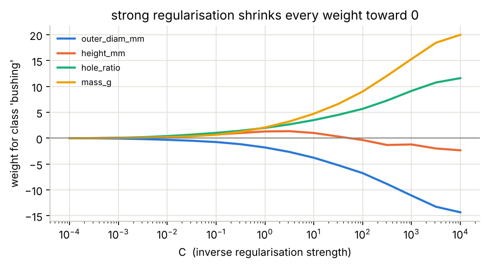

*Figure 2.5 — Weights of the "bushing" class as `C` varies. Strong regularisation (small `C`)
pulls every weight toward zero.*

With all four features the test accuracy jumps from 0.87 to 0.99. The reason is
`hole_ratio`: it is exactly the measurement that distinguishes a nut (small hole) from a bushing
(large hole). **Choosing the right feature mattered more than choosing the right model** — a
theme that returns in every chapter of this book.

## 2.4 Support vector machines

### Maximum margin

When two classes can be separated by a line, infinitely many lines do it. The **support vector
machine** picks the one with the largest **margin** — the largest distance to the nearest
training points, called **support vectors**. With labels $y\in\{-1,+1\}$ the hard-margin SVM
solves

$$\min_{\mathbf w,b}\ \tfrac12\lVert\mathbf w\rVert^2\quad\text{subject to}\quad y^{(i)}\big(\mathbf w^\top\mathbf x^{(i)}+b\big)\ge1\ \ \forall i.$$

Real data overlaps, so the **soft-margin** SVM introduces slack variables $\xi_i\ge0$ that allow
violations at a cost:

$$\min\ \tfrac12\lVert\mathbf w\rVert^2 + C\sum_i\xi_i.$$

Large `C` buys fewer violations with a narrower margin; small `C` accepts more violations for a
wider margin.

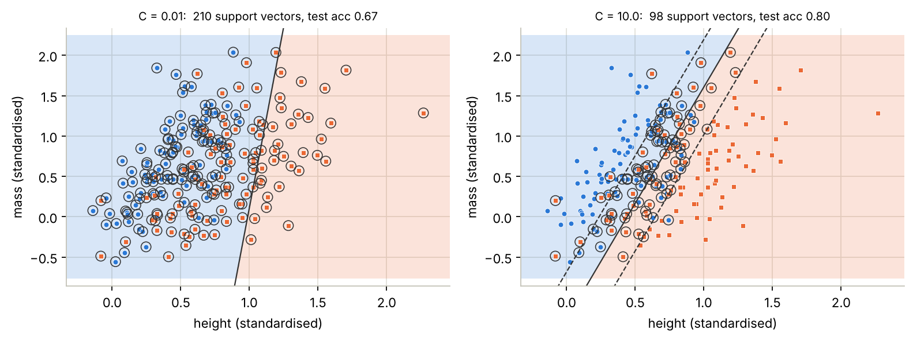

*Figure 2.6 — Linear SVM on nut vs bushing. Circled points are support vectors; dashed lines
are the margin. With `C = 0.01` the margin swallows almost all the data and the boundary lands
in the wrong place (test accuracy 0.67). With `C = 10` it agrees with logistic regression (0.80).*

Only the support vectors determine the SVM boundary; moving any other training point (without
crossing the margin) changes nothing. That makes SVMs robust to points far from the boundary.

### A problem no straight line can solve: the reachable workspace

Consider a planar two-link robot arm with link lengths $L_1=0.40$ m and $L_2=0.25$ m. A target
point at distance $r$ from the base can be reached only if

$$|L_1-L_2|\le r\le L_1+L_2,$$

so the reachable set is an **annulus**. We ask a classifier to learn "reachable / unreachable"
from labelled $(x,y)$ samples, with a little label noise near the edges to mimic calibration
error. No straight line can separate a ring from its inside and outside — the linear SVM in
Figure 2.7 scores 54 %, the same as always guessing the majority class.

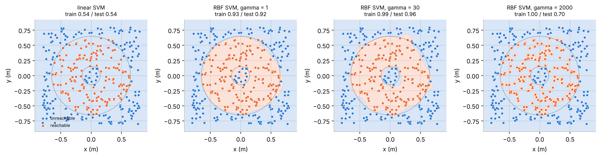

*Figure 2.7 — Dotted circles are the true inner and outer reach. From left to right: linear SVM;
RBF SVM with γ = 1 (too smooth), γ = 30 (close to the truth), γ = 2000 (overfitted islands).*

### The kernel trick

The SVM's optimisation problem can be written so that the training data appear only through dot
products $\mathbf x^{(i)\top}\mathbf x^{(j)}$. Replacing every dot product with a **kernel
function** — for example the **radial basis function** (RBF)

$$k\big(\mathbf x^{(i)},\mathbf x^{(j)}\big)=\exp\!\Big(-\gamma\,\big\lVert\mathbf x^{(i)}-\mathbf x^{(j)}\big\rVert^2\Big)$$

— is equivalent to running the linear SVM in a much higher-dimensional feature space, without
ever computing the new features. In that space the ring is linearly separable.

You can see the idea with a single hand-made feature: add $x^2+y^2$ and the annulus becomes a
horizontal slab, separable by two thresholds (Figure 2.8). The RBF kernel finds such features
automatically.

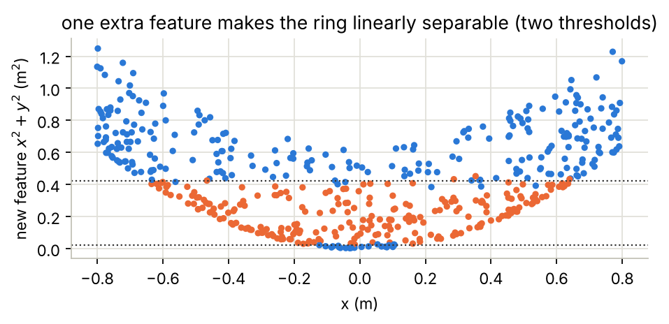

*Figure 2.8 — With the extra feature $x^2+y^2$ the reachable points lie between two horizontal
lines.*

The parameter $\gamma$ sets how far each training point's influence reaches. Small $\gamma$ gives
smooth boundaries that may be too simple (γ = 1 cannot bend tightly around the small inner hole,
test accuracy 0.92). Moderate $\gamma$ recovers the annulus (γ = 30, test 0.96). Very large
$\gamma$ gives every training point its own island: training accuracy is perfect and test
accuracy collapses to 0.70. That is **overfitting**, and $\gamma$ and `C` are the
**hyperparameters** that control it. Chapter 6 shows how to choose them systematically.

## 2.5 Decision trees

A decision tree classifies by asking a sequence of yes/no questions about single features —
"is mass ≤ 11 g?" — exactly as a PLC programmer would write a sorting rule by hand.

### Impurity and information gain

The learning algorithm chooses each question to make the resulting groups as **pure** as
possible. For a node in which class $k$ has proportion $p_k$, three impurity measures are common:

| measure | formula |
|---|---|
| entropy | $I_H=-\sum_k p_k\log_2 p_k$ |
| Gini impurity | $I_G=1-\sum_k p_k^2$ |
| classification error | $I_E=1-\max_k p_k$ |

A split of a parent node $D_p$ into children $D_\text{left}$ and $D_\text{right}$ is scored by
its **information gain**

$$IG=I(D_p)-\frac{N_\text{left}}{N_p}I(D_\text{left})-\frac{N_\text{right}}{N_p}I(D_\text{right}),$$

and the tree greedily takes the best split at every node.

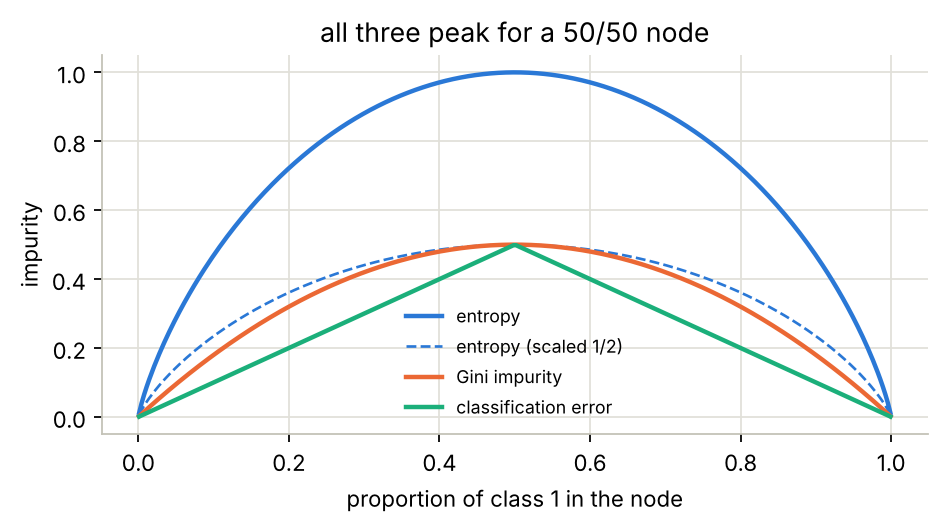

*Figure 2.9 — For two classes, all three measures are zero for a pure node and peak at a 50/50
mix. Entropy and Gini behave almost identically; classification error is less sensitive to
changes in the class mix and is rarely used for growing trees.*

### Trees in engineering units

Because each split compares one feature with a threshold, trees **do not need feature
scaling**, and their rules come out in the units the operator knows.

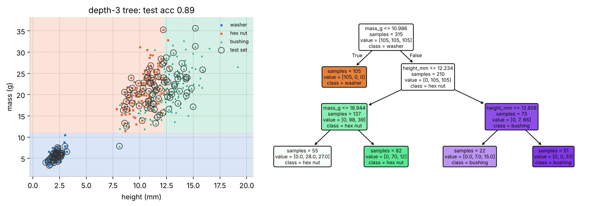

*Figure 2.10 — Left: the boundary of a depth-3 tree is made of axis-parallel rectangles.
Right: the tree itself. The first question, mass ≤ 11 g, separates every washer.*

### Depth controls complexity

An unrestricted tree keeps splitting until every leaf is pure, which memorises the training set.
Figure 2.11 shows the usual picture: training accuracy rises to 100 % with depth, test accuracy
peaks early and then falls slightly.

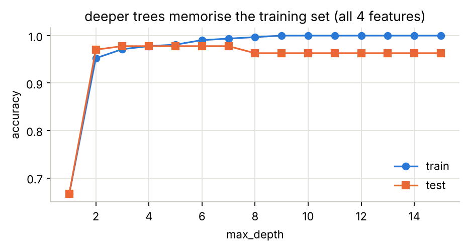

*Figure 2.11 — Train and test accuracy against `max_depth`, all four features.*

A tree also reports **feature importances** — how much each feature reduced impurity across all
its splits. For a depth-4 tree on all four features, mass and hole ratio carry over 90 % of the
importance. Single trees are unstable, however: a few changed training parts can change the
splits completely. Averaging many randomised trees — a **random forest** — is the subject of
Chapter 4.

## 2.6 k-nearest neighbours

The k-nearest-neighbour (k-NN) classifier does no training at all. To classify a new part it
finds the $k$ training parts closest to it and takes a majority vote. It is the clearest example
of a **non-parametric** or **instance-based** method: the "model" is the stored training set.

Two choices define it: the number of neighbours $k$ and the distance metric. The default,
Euclidean distance, adds up squared differences in each feature, so **the feature with the
largest numeric range dominates**. On raw features — mass spans about 25 g, hole ratio about
0.3 — k-NN reaches 0.87 test accuracy; after standardisation, 0.99.

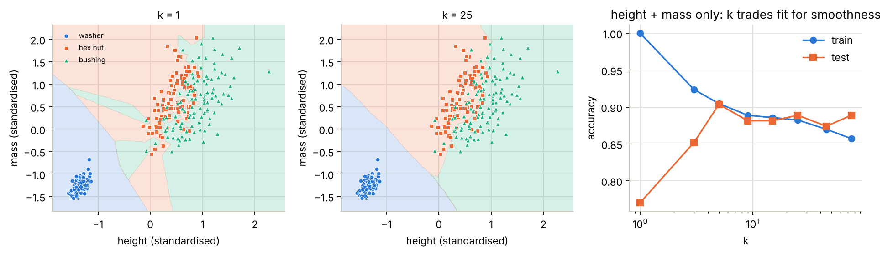

*Figure 2.12 — Height and mass only. With k = 1 the boundary follows every training point;
with k = 25 it is smooth. Right: training accuracy falls as k grows, test accuracy peaks at a
moderate k.*

Two practical cautions. **Prediction cost grows with the training set**, because every
prediction searches all stored samples — significant when a diverter has a 10 ms window and you
have millions of logged parts. And with many features, the **curse of dimensionality** makes
"nearest" neighbours stop being near; Chapter 5 shows how to compress features first.

## 2.7 Head-to-head

The notebook finally trains all four classifiers on all four features with the same split, with
scaling placed inside a `Pipeline` so it is always fitted on the training data:

| model | train acc. | test acc. |
|---|---|---|
| logistic regression | 0.994 | 0.993 |
| linear SVM | 0.990 | 0.993 |
| RBF SVM | 0.994 | 0.993 |
| decision tree (depth 4) | 0.978 | 0.978 |
| k-NN (k = 9) | 0.975 | 0.993 |

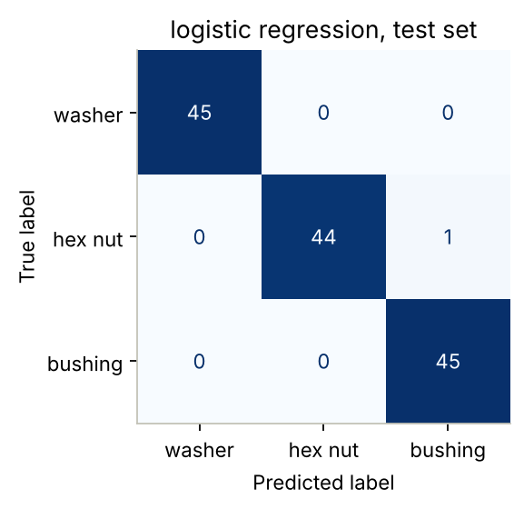

*Figure 2.13 — Logistic regression on the test set: one hex nut sorted as a bushing, every
other part correct.*

With the right features, every classifier sorts almost perfectly, and the remaining errors are
all nut/bushing confusions. The differences between *models* are much smaller than the
difference between two features and four. On a production line the choice then rests on what the
accuracy table does not show:

* **Interpretability** — a shallow tree can be read, checked and even re-implemented in ladder
  logic by the controls engineer.
* **Calibrated probabilities** — logistic regression's $\hat p$ drives a reject lane.
* **Prediction cost** — the notebook also times each model; k-NN is several times slower per
  part than the others, and the gap grows with the training set.
* **Boundary shape** — if you know the classes are separated by a curved region (the workspace
  example), a linear model will not do, however much data you collect.

## Summary

* A classifier maps measurements to a decision; it is learned from labelled examples and judged
  on examples it has not seen.
* Split first; fit scaling and every other preprocessing step on the training set only.
* **Logistic regression** draws a straight boundary and outputs a probability.
* **SVMs** maximise the margin; kernels let them draw curved boundaries; `C` and `gamma`
  control complexity.
* **Decision trees** draw axis-parallel boxes, need no scaling, and are readable; depth controls
  complexity.
* **k-NN** draws arbitrary local boundaries, needs scaling, and pays at prediction time.
* Better features often beat a better model.

## Exercises

1. Retrain `LogisticRegressionGD` on **unscaled** height and mass. Find the largest learning
   rate that still converges, and explain it in terms of the shape of the loss surface.
2. Add `hole_ratio` to the nut/bushing problem. How much does test accuracy improve, and which
   weight becomes largest?
3. Give the two-link arm a joint limit $0\le q_2\le150^\circ$ (elbow-up only) and regenerate the
   labels with inverse kinematics. How does the reachable region change, and which `gamma` now
   works best?
4. Subsample the training set at 10 %, 20 %, …, 100 % and plot test accuracy of a depth-4 tree.
   How many labelled parts does the cell really need?
5. Use Manhattan distance (`p=1`) in k-NN. Does it matter for four features? Argue why it might
   matter for fifty.
