# Chapter 5 — Compressing and Grouping Machine Data

> **Companion notebook:** [`ch05_dimred_clustering.ipynb`](ch05_dimred_clustering.ipynb).
> Every figure and number in this chapter comes from it; it needs no download.
> For density-based clustering, see also the DBSCAN notebooks in `lectures/lect05/supplement/`
> (CNC spindle, robot joint torques, wind-turbine SCADA).

## 5.1 Two questions machines keep asking

Machines produce many correlated signals. The wrist-gearbox monitor of Chapter 4 condenses each
nightly recording into 13 indicators; a modern servo drive can stream hundreds of variables. Two
questions keep coming up:

* **Can the machine be described with fewer numbers?** — to plot it on a dashboard, to fit a
  model into a PLC, to remove noise, or simply to *see* the data. This is **dimensionality
  reduction**.
* **Without labels, which operating modes does the machine actually run in?** This is
  **clustering**.

This chapter answers the first question with **principal component analysis** (PCA, unsupervised)
and **linear discriminant analysis** (LDA, supervised) on the gearbox data, and the second with
**k-means** on the cycle log of a palletising robot cell.

## 5.2 Redundancy in the gearbox data

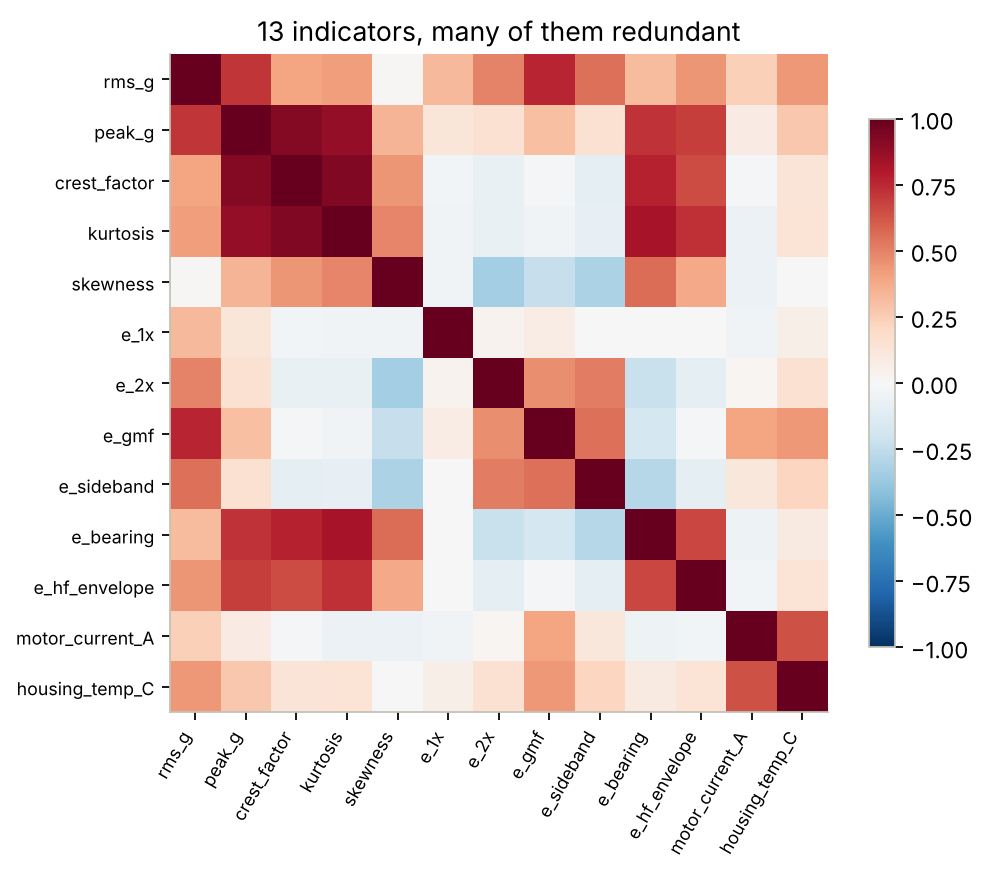

*Figure 5.1 — Correlations between the 13 standardised indicators.*

Figure 5.1 shows large blocks of strong correlation. RMS, peak, crest factor and kurtosis all
respond to the same mechanical impacts; gear-mesh energy, current and temperature all follow the
load of the test move. Thirteen columns carry far fewer than thirteen independent pieces of
information.

## 5.3 Principal component analysis

PCA finds a new set of orthogonal axes — the **principal components** — ordered so that the
first captures as much of the data's variance as possible, the second as much of the remainder as
possible, and so on. Keeping only the first few components gives a compressed description that
loses as little variance as possible.

### Step by step

For a standardised data matrix $X$ ($n$ samples × $d$ features):

1. compute the covariance matrix $\Sigma=\frac{1}{n-1}X^\top X$;
2. find its eigenvalues and eigenvectors, $\Sigma\mathbf v_j=\lambda_j\mathbf v_j$;
3. sort by decreasing eigenvalue: $\mathbf v_1$ is the direction of largest variance, and
   $\lambda_1$ is that variance;
4. stack the first $k$ eigenvectors into a projection matrix $W$ ($d\times k$) and project,
   $Z=XW$.

The **explained-variance ratio** of component $j$ is $\lambda_j/\sum_i\lambda_i$.

Standardising first is essential. PCA maximises variance, so a feature measured in large units
(temperature in °C, say) would otherwise dominate the first component purely because of its
units.

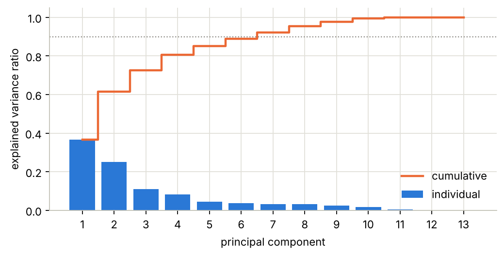

*Figure 5.2 — Individual and cumulative explained-variance ratios of the 13 principal
components.*

The first two components explain 62 % of the variance; seven are needed for 90 %. The last two
eigenvalues are close to zero: `peak_g` is `crest_factor` × `rms_g`, and `rms_g` is computed
from the band energies. Those relations are nonlinear, so the redundancy is not exact, but in
practice the data lives in about 11 dimensions, not 13.

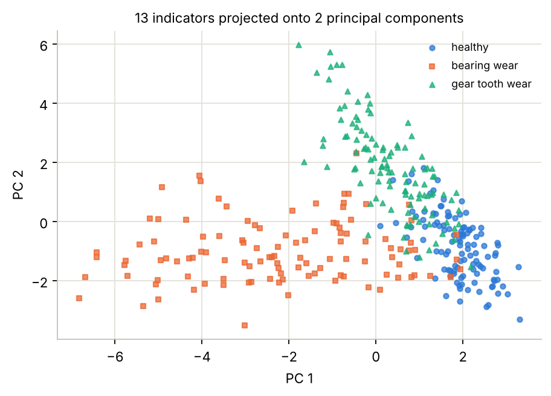

*Figure 5.3 — The training recordings projected onto PC 1 and PC 2, coloured by their (unused)
labels.*

PCA never saw the labels, yet bearing wear and gear wear spread out along different directions,
because faults create most of the variance. Healthy units and incipient faults still overlap near
one corner: **the directions of largest variance are not necessarily the directions that best
separate the classes.**

### Loadings: what a component means

scikit-learn's `PCA` reproduces the manual eigen-decomposition exactly (up to the sign of each
eigenvector, which is arbitrary). To interpret a component, compute its **loadings**,
$v_{jk}\sqrt{\lambda_k}$ — the correlation between original feature $j$ and component $k$.

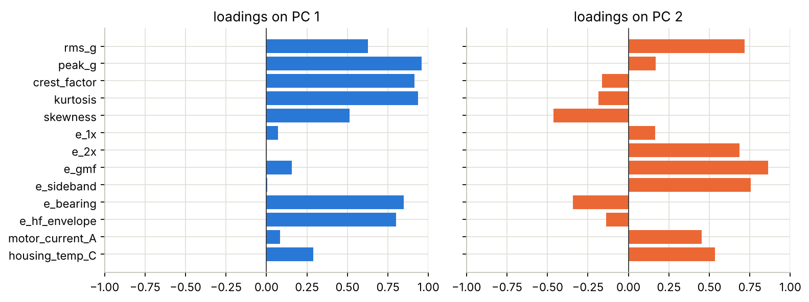

*Figure 5.4 — Loadings of the 13 indicators on PC 1 and PC 2.*

PC 1 gathers the **impact** family: peak, crest factor, kurtosis, bearing-band energy, HF
envelope. PC 2 gathers the **load and gear-mesh** family: RMS, 2× energy, mesh energy, sidebands,
current, temperature. PCA has turned 13 sensors into two interpretable "health axes" without any
labels — which is exactly what you need for a fleet of robots that nobody has labelled.

## 5.4 Linear discriminant analysis

LDA uses the labels. It looks for directions that maximise the spread **between** class means
relative to the spread **within** each class.

With class means $\mathbf m_c$, overall mean $\mathbf m$ and $n_c$ samples in class $c$:

* **within-class scatter** $S_W=\sum_c\sum_{\mathbf x\in c}(\mathbf x-\mathbf m_c)(\mathbf x-\mathbf m_c)^\top$
  (the notebook uses the sum of class covariance matrices, a scaled version that is more robust
  to unequal class sizes);
* **between-class scatter** $S_B=\sum_c n_c(\mathbf m_c-\mathbf m)(\mathbf m_c-\mathbf m)^\top$;
* the **linear discriminants** are the eigenvectors of $S_W^{-1}S_B$, ordered by eigenvalue.

$S_B$ is a sum of $C$ rank-one matrices whose deviations from the overall mean sum to zero, so its
rank is at most $C-1$. With three classes there are **at most two non-zero discriminants**, no
matter how many features you start with.

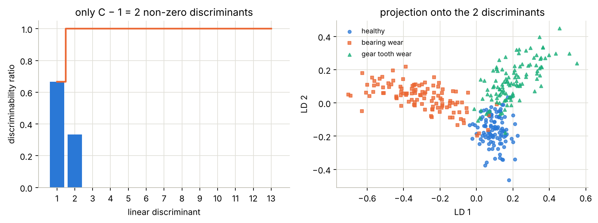

*Figure 5.5 — Left: only two discriminants carry information (67 % and 33 % of
discriminability). Right: projection onto them.*

Compare Figure 5.5 with Figure 5.3: the three conditions now form three much tighter groups.
LDA spends its two dimensions on exactly what separates the classes.

LDA assumes that the classes are roughly Gaussian with similar covariance matrices. It remains
useful when that is only approximately true, as here, but it can mislead when one class is, for
example, multimodal.

## 5.5 PCA or LDA as preprocessing?

The practical question: if a downstream classifier may only receive **two numbers** per
recording — because it must run on a small embedded controller, say — where should those numbers
come from?

| inputs to logistic regression | CV accuracy | test accuracy |
|---|---|---|
| all 13 features | 0.935 | 0.944 |
| 2 PCA components | 0.860 | 0.840 |
| **2 LDA components** | **0.929** | **0.903** |
| best pair of raw features (`e_bearing`, `e_sideband`) | 0.872 | 0.889 |

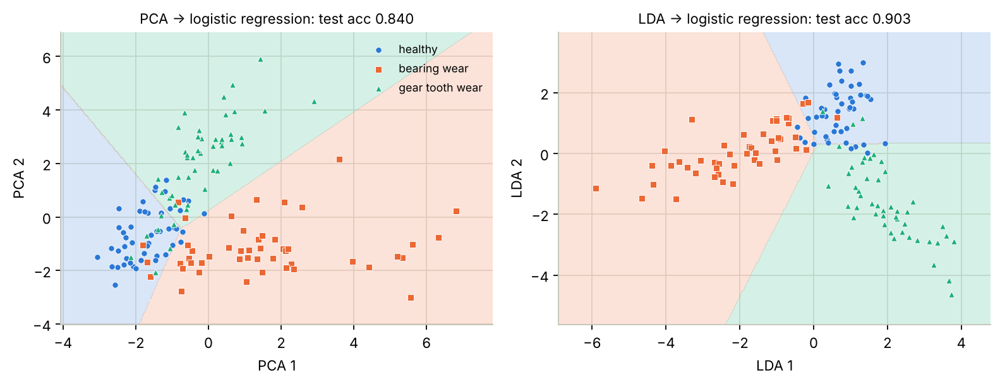

*Figure 5.6 — Logistic regression on two PCA components (left) and two LDA components (right),
test set.*

With two numbers, LDA keeps nearly all of the full model's cross-validated accuracy; PCA loses a
substantial part of it; the best hand-picked pair of raw sensors lands in between. The general
rule:

* **PCA** is unsupervised. Use it to visualise, de-noise or compress when there are no labels, or
  when the downstream task is not yet known.
* **LDA** is supervised. When you have labels and the goal is classification, it compresses *for
  that goal*, but it gives at most $C-1$ components.

Both are linear. For curved structure the classical extension is kernel PCA; in current practice
t-SNE and UMAP serve for visualisation and autoencoders (neural networks, later in this book) for
nonlinear compression.

## 5.6 Clustering a robot cell's cycle log

A palletising robot handles three product variants, but the cell controller does not record which
variant was on the conveyor. For every cycle it does log the **cycle time** and the **energy**
drawn by the robot. Can the operating modes be recovered from those two numbers alone? There are
no labels, so this is **clustering**.

The simulator produces 450 cycles from three variants of unequal frequency (220, 140 and 90
cycles): light boxes on a low pallet pattern, light boxes on a taller pattern (longer motions),
and heavy boxes (more energy per second). The variant labels are hidden and used only to check
the result.

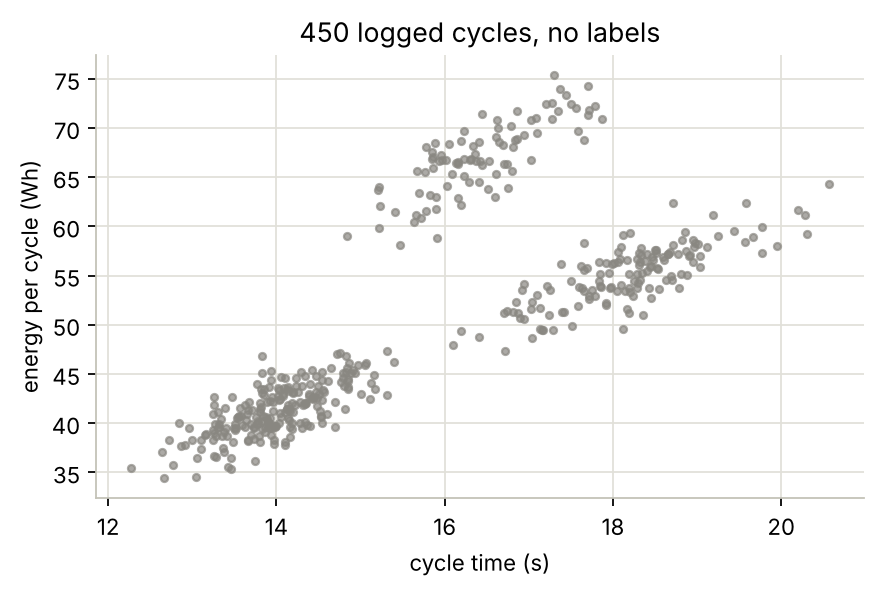

*Figure 5.7 — 450 cycles, no labels.*

### The k-means algorithm

k-means looks for $k$ centroids $\boldsymbol\mu_1,\dots,\boldsymbol\mu_k$ that minimise the
**within-cluster sum of squared errors** (SSE, or *inertia*):

$$\text{SSE}=\sum_{i=1}^n\min_j\big\lVert\mathbf x^{(i)}-\boldsymbol\mu_j\big\rVert^2.$$

Lloyd's algorithm alternates two steps until the centroids stop moving:

1. **assign** each point to its nearest centroid;
2. **update** each centroid to the mean of its assigned points.

Neither step can increase the SSE, so the algorithm always converges — but to a *local* minimum
that depends on the initial centroids. Because it uses Euclidean distance, the features must be
**standardised** first: cycle time spans a few seconds, energy tens of watt-hours.

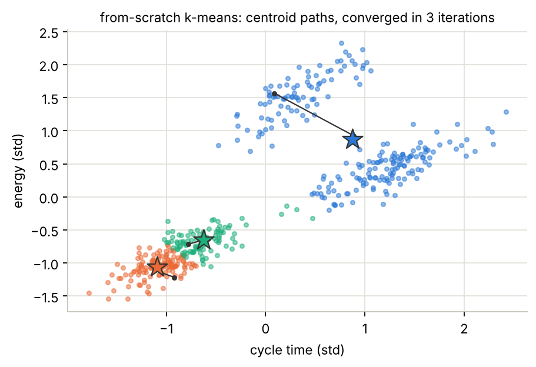

*Figure 5.8 — The notebook's from-scratch implementation: paths of the three centroids from
their random starting points to convergence.*

### Bad starts and k-means++

Running the plain algorithm from 50 random starts, only about half reach the best SSE; the worst
gets stuck at twice the best value, with two centroids inside one true group and one straddling the
other two. **k-means++** chooses initial centroids that are spread out — each new centroid drawn
with probability proportional to its squared distance from the nearest centroid already chosen —
and reaches the best solution in 49 of 50 single runs. scikit-learn's `KMeans` uses k-means++ by
default and keeps the best of several runs (`n_init`).

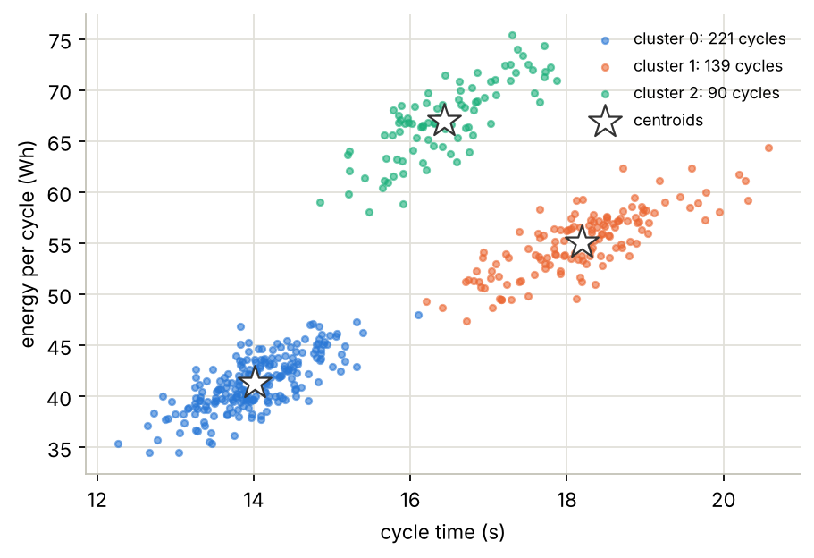

*Figure 5.9 — scikit-learn k-means with k = 3. Stars are the centroids: (14.0 s, 41 Wh),
(18.2 s, 55 Wh) and (16.4 s, 67 Wh).*

Since the data is simulated, we can compare the clusters with the hidden variants using the
**adjusted Rand index** (ARI), which is 1 for perfect agreement and about 0 for chance, regardless
of how clusters are numbered. On standardised data k-means scores **ARI = 0.99** — one cycle out
of 450 is assigned to the wrong variant. On raw, unscaled data the ARI drops to 0.94.

## 5.7 How many clusters?

In practice nobody tells you $k$. Two standard diagnostics:

* **The elbow method.** SSE always decreases as $k$ grows. Plot it and look for the point where
  adding another cluster stops paying off.
* **Silhouette analysis.** For each sample, let $a$ be its mean distance to the other members of
  its cluster and $b$ its mean distance to the members of the nearest other cluster. Its
  silhouette coefficient is

  $$s=\frac{b-a}{\max(a,b)}\in[-1,1].$$

  Near 1: deep inside its own cluster. Near 0: on a border. Negative: probably in the wrong
  cluster. The mean silhouette is a single score for comparing values of $k$.

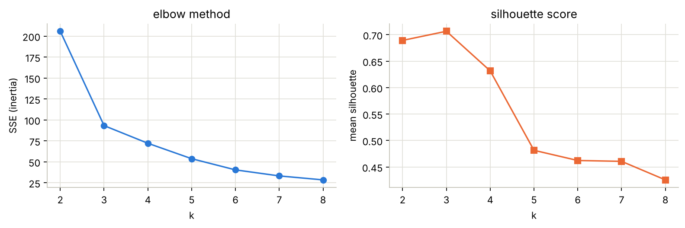

*Figure 5.10 — SSE and mean silhouette for k = 2 … 8.*

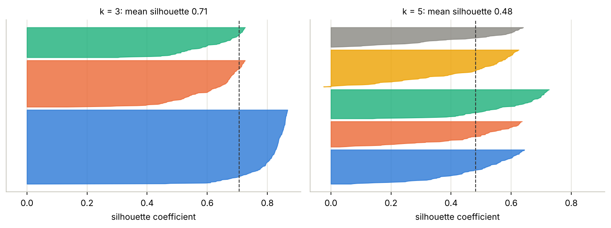

*Figure 5.11 — Silhouette coefficients of every cycle, grouped by cluster.*

With $k=3$ the silhouette coefficients are high in all three clusters (mean 0.71) and almost no
cycle is near zero. With $k=5$ the true groups are cut in pieces, coefficients drop in every
cluster, a few become negative, and the mean falls to 0.48. Both diagnostics point to three
operating modes — the three variants we hid.

### Where k-means struggles

k-means assumes roughly round clusters of similar spread, and it assigns *every* point to some
cluster. Elongated or nested shapes, and outliers that belong to no mode at all — an operator
stop, a jam, a safety-fence trip — call for density-based methods such as **DBSCAN**, which
finds dense regions of any shape and labels isolated points as noise. The DBSCAN notebooks that
accompany this chapter apply it to condition monitoring of a CNC spindle, robot joint torques and
wind-turbine SCADA data.

## Summary

* Correlated sensors carry fewer independent pieces of information than their number suggests.
* **PCA** is unsupervised and finds directions of maximum variance. Standardise first; read the
  components through their loadings.
* **LDA** is supervised and finds directions of maximum class separation, at most $C-1$ of them.
  It is the better compressor when the goal is classification.
* **k-means** minimises within-cluster SSE by alternating assignment and update. Standardise first,
  use k-means++ with several restarts, and choose $k$ with the elbow method and silhouette analysis.
* For irregular shapes and noise points, use density-based clustering (DBSCAN).

## Exercises

1. Keep enough principal components to explain 95 % of the variance and train logistic regression
   on them. How close do you get to the all-feature accuracy, and with how many components?
2. Fit PCA on **healthy** recordings only, then compute the reconstruction error of every test
   recording. Do faulty units have larger errors? (This is a classic unsupervised anomaly
   detector.)
3. Remove `e_bearing` and `e_sideband` and repeat §5.5. Which method suffers more, PCA or LDA, and
   why?
4. Add a fourth logged variable — the robot's peak joint-3 torque, higher for the taller pallet
   pattern — and recluster. Does the ARI change?
5. Add 20 "jam" cycles (30–60 s, low energy) to the log. What does k-means do with them? Try
   `sklearn.cluster.DBSCAN`.
